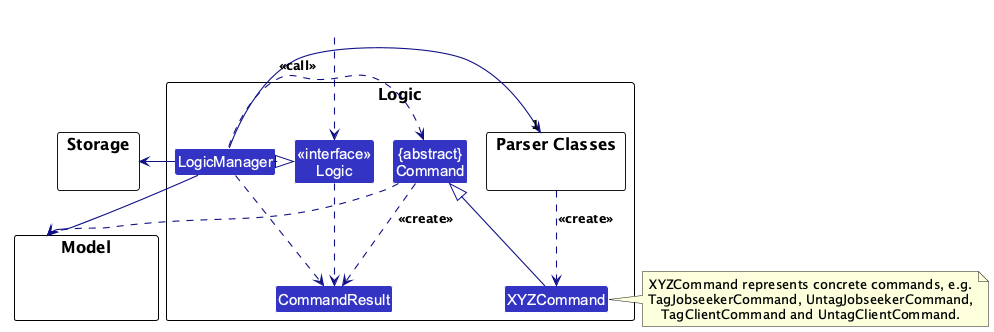
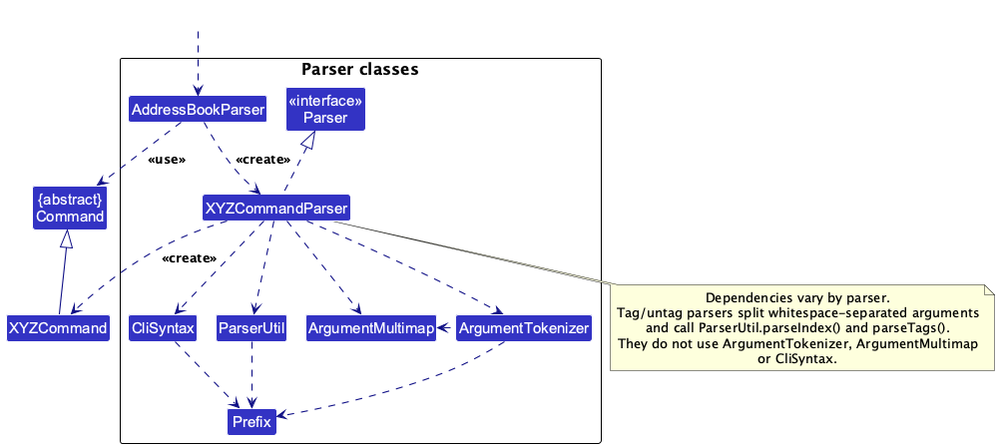
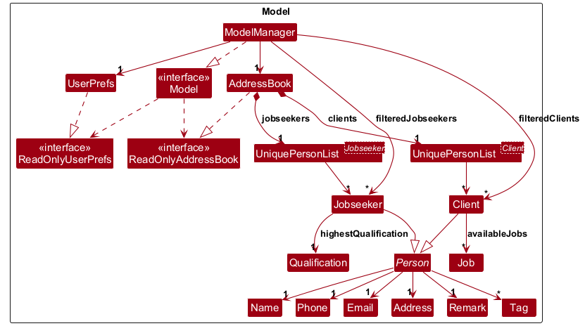
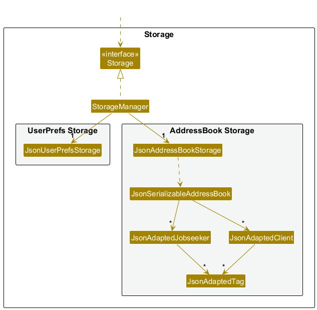
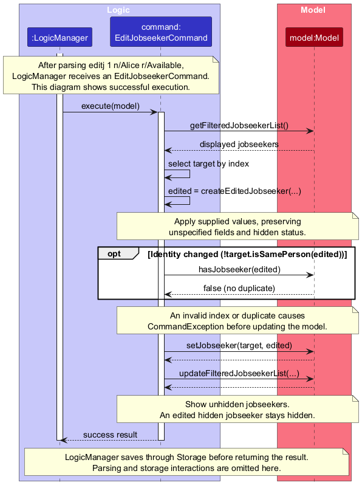
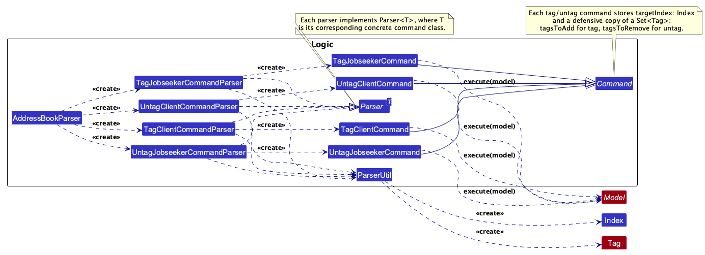
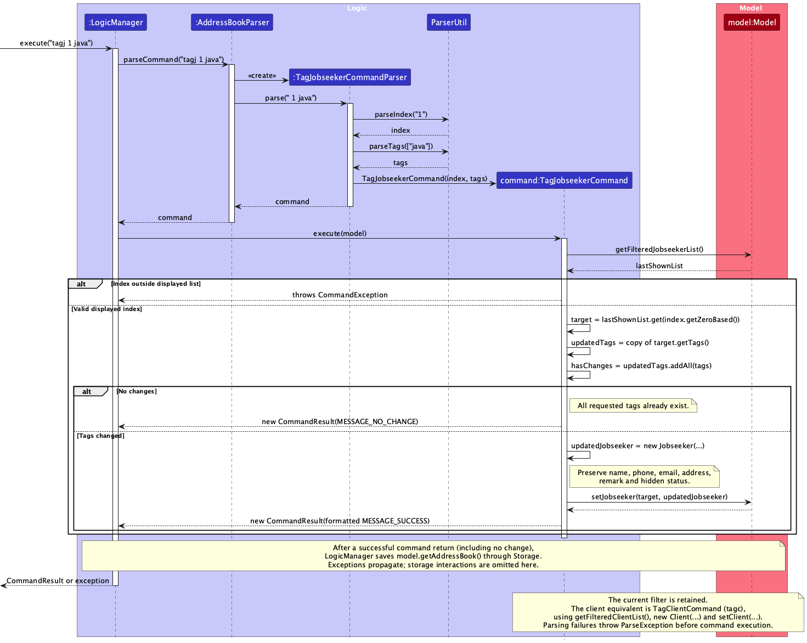
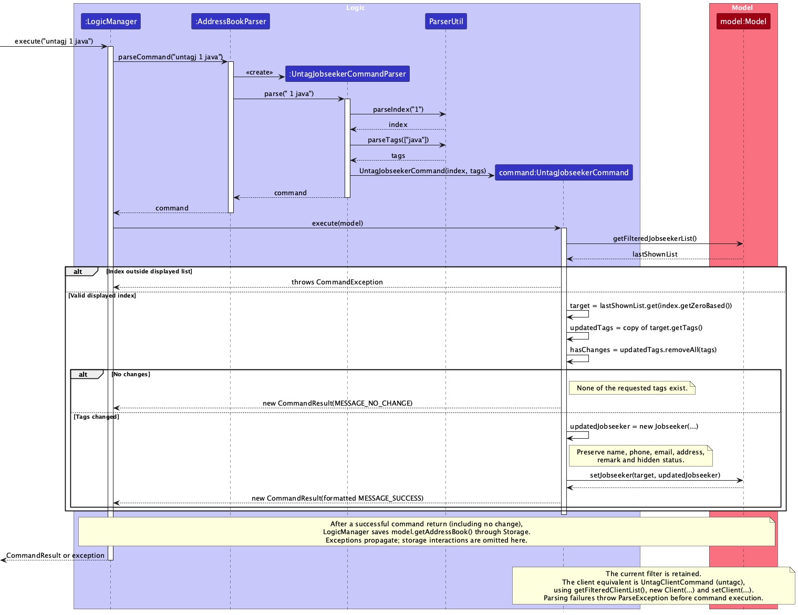

* Table of Contents
{:toc}

--------------------------------------------------------------------------------------------------------------------

## **Acknowledgements**

* _{List the sources of reused or adapted ideas, code, documentation, and third-party libraries here, with links to the originals.}_

--------------------------------------------------------------------------------------------------------------------

## **Setting up, getting started**

Refer to the guide [_Setting up and getting started_](SettingUp.md).

--------------------------------------------------------------------------------------------------------------------

## **Design**

:bulb: **Tip:** The `.puml` files used to create diagrams are in `docs/diagrams`. Refer to the [_PlantUML Tutorial_ at se-edu/guides](https://se-education.org/guides/tutorials/plantUml.html) to learn how to create and edit diagrams.

### Architecture

The ***Architecture Diagram*** given above explains the high-level design of the App.

The following provides a quick overview of the main components and their interactions.

**Main components of the architecture**

**`Main`** (consisting of classes [`Main`](https://github.com/se-edu/addressbook-level3/tree/master/src/main/java/seedu/address/Main.java) and [`MainApp`](https://github.com/se-edu/addressbook-level3/tree/master/src/main/java/seedu/address/MainApp.java)) is in charge of the app launch and shut down.
* At app launch, it initializes the other components in the correct sequence, and connects them up with each other.
* At shut down, it shuts down the other components and invokes cleanup methods where necessary.

The bulk of the app's work is done by the following four components:

* [**`UI`**](#ui-component): The UI of the App.
* [**`Logic`**](#logic-component): The command executor.
* [**`Model`**](#model-component): Holds the data of the App in memory.
* [**`Storage`**](#storage-component): Reads data from, and writes data to, the hard disk.

[**`Commons`**](#common-classes) represents a collection of classes used by multiple other components.

**How the architecture components interact with each other**

The *Sequence Diagram* below shows how the components interact with each other for the scenario where the user issues the command `delete 1`.

Each of the four main components (also shown in the diagram above),

* defines its *API* in an `interface` with the same name as the Component.
* provides its functionality through a concrete `{Component Name}Manager` class that implements the corresponding API interface.

For example, the `Logic` component defines its API in `Logic.java` and implements it in `LogicManager.java`. Other components interact with a component through its interface rather than its concrete class, preventing them from coupling to that component's implementation, as illustrated in the following partial class diagram.

The sections below give more details of each component.

### UI component

The **API** of this component is specified in [`Ui.java`](https://github.com/se-edu/addressbook-level3/tree/master/src/main/java/seedu/address/ui/Ui.java)

The UI consists of a `MainWindow` and its parts, such as `CommandBox`, `ResultDisplay`, `PersonListPanel`, and `StatusBarFooter`. All of these, including `MainWindow`, inherit from the abstract `UiPart` class, which captures common behavior among classes that represent visible GUI parts.

The `UI` component uses the JavaFX UI framework. The layouts of these UI parts are defined in matching `.fxml` files in `src/main/resources/view`. For example, [`MainWindow.fxml`](https://github.com/se-edu/addressbook-level3/tree/master/src/main/resources/view/MainWindow.fxml) specifies the layout of [`MainWindow`](https://github.com/se-edu/addressbook-level3/tree/master/src/main/java/seedu/address/ui/MainWindow.java).

The `UI` component,

* executes user commands using the `Logic` component.
* listens for changes to `Model` data so that the UI can be updated with the modified data.
* keeps a reference to the `Logic` component, because the `UI` relies on the `Logic` to execute commands.
* depends on some classes in the `Model` component because it displays `Person` objects from the model.

### Logic component

**API** : [`Logic.java`](https://github.com/se-edu/addressbook-level3/tree/master/src/main/java/seedu/address/logic/Logic.java)

Here's a (partial) class diagram of the `Logic` component:

The sequence diagram below illustrates the interactions within the `Logic` component, taking `execute("deletec 1")` API call as an example.

:information_source: **Note:** The lifeline for `DeleteClientCommandParser` should end at the destroy marker (X), but due to a limitation of PlantUML, it continues to the end of the diagram.

How the `Logic` component works:

1. When `Logic` is called upon to execute a command, the command is passed to an `AddressBookParser` object, which in turn creates a parser that matches the command (e.g., `DeleteClientCommandParser`) and uses it to parse the command.
1. This results in a `Command` object (more precisely, an object of one of its subclasses e.g., `DeleteClientCommand`) which is executed by the `LogicManager`.
1. The command can communicate with the `Model` when it is executed (e.g. to delete a client). 
   Note that although this is shown as a single step in the diagram above for simplicity, the code can require several interactions between the command object and the `Model` to complete the operation.
1. The result of the command execution is encapsulated as a `CommandResult` object which is returned from `Logic`.

Here are the other classes in `Logic` (omitted from the class diagram above) that are used for parsing a user command:

How the parsing works:
* When called upon to parse a user command, the `AddressBookParser` class creates an `XYZCommandParser` (`XYZ` is a placeholder for the specific command name, e.g., `AddJobseekerCommandParser`). The parser uses the other classes shown above to parse the user command and create an `XYZCommand` object (e.g., `AddJobseekerCommand`). The `AddressBookParser` returns that object as a `Command` object.
* All `XYZCommandParser` classes, such as `AddJobseekerCommandParser` and `TagJobseekerCommandParser`, implement the `Parser` interface so they can be treated similarly where appropriate, for example during testing.

* Parser dependencies vary by command. Tag/untag parsers split whitespace-separated arguments and use `ParserUtil.parseIndex()` and `ParserUtil.parseTags()` directly; they do not use `ArgumentTokenizer`, `ArgumentMultimap`, or `CliSyntax`.

### Model component
**API** : [`Model.java`](https://github.com/se-edu/addressbook-level3/tree/master/src/main/java/seedu/address/model/Model.java)

The `Model` component,

* stores jobseekers and clients in separate `UniquePersonList<Jobseeker>` and `UniquePersonList<Client>` collections. Both types extend the abstract `Person` class.
* exposes separate filtered `ObservableList<Jobseeker>` and `ObservableList<Client>` views that the UI observes.
* stores an optional highest qualification in each `Jobseeker` as a `Qualification` value object. An empty value means unspecified. Each `Client` stores an immutable `Set<Job>` of available jobs; an empty set means no jobs specified. These fields affect equality but do not change contact identity (phone and email).
* stores a `UserPrefs` object that represents the user’s preferences (currently, just the GUI settings). This is exposed to the outside as a `ReadOnlyUserPrefs` object.
* does not depend on any of the other three components (as the `Model` represents data entities of the domain, they should make sense on their own without depending on other components)

:information_source: **Note:** The alternative, arguably more object-oriented, design below keeps a unique list of tags in `AddressBook`, and each `Person` references tags from that list. This lets `AddressBook` maintain one `Tag` object per unique tag instead of each `Person` holding its own `Tag` objects. 

### Storage component

**API** : [`Storage.java`](https://github.com/se-edu/addressbook-level3/tree/master/src/main/java/seedu/address/storage/Storage.java)

The `Storage` component,
* can save both address book data and user preference data in JSON format, and read them back into corresponding objects.
* is implemented by `StorageManager`, which delegates the actual JSON file access to `JsonAddressBookStorage` and `JsonUserPrefsStorage` (one class per data file).
* depends on some classes in the `Model` component (because the `Storage` component's job is to save/retrieve objects that belong to the `Model`)

`JsonAdaptedJobseeker` persists `highestQualification` as a string, and `JsonAdaptedClient` persists `availableJobs` as an array of job titles. Missing or null fields default to an empty qualification or job set, allowing older files to load. Blank or null entries inside the jobs array are rejected as invalid data.

### Common classes

Classes used by multiple components are in the `seedu.address.commons` package.

--------------------------------------------------------------------------------------------------------------------

## **Implementation**

This section describes some noteworthy details on how certain features are implemented.

### Edit jobseeker feature

The `editj` command updates a jobseeker identified by their one-based index in the currently displayed jobseeker list. `AddressBookParser` delegates to `EditCommandParser`, which creates an `EditJobseekerCommand` containing an `Index` and a defensive copy of an `EditJobseekerDescriptor`.

The following sequence diagram focuses on successful execution of `editj 1 n/Alice r/Available`, after parsing has created the command. Local aliases `target` and `edited` represent the original and replacement jobseekers. Parsing, error paths, and storage details are explained below; `...` indicates omitted parameters.

#### Parsing and optional fields

`EditCommandParser` tokenizes the arguments using `ArgumentTokenizer`, parses the index with `ParserUtil.parseIndex()`, and rejects repeated `n/`, `p/`, `e/`, `a/`, `r/`, or `q/` prefixes. It validates the supplied fields and populates `EditJobseekerDescriptor`. Invalid input or a descriptor with no supplied fields causes a `ParseException` before execution.

Unspecified fields remain unchanged. For remarks, an omitted `r/` leaves the descriptor's remark unset, while an empty `r/` supplies `new Remark("")` to clear the existing remark. Supplied tags replace the existing set; `t/` alone supplies an empty set to clear all tags.

Jobseeker qualifications follow the same omitted/empty distinction: `q/` supplies an empty `Qualification`, while omitting it preserves the current value. For clients, `EditClientCommandParser` accepts repeated `j/` prefixes and supplies a replacement `Set<Job>` to `EditClientDescriptor`. `j/` alone clears the set; blank entries mixed with other jobs are rejected. Hide, unhide, tag, and untag commands preserve these fields when constructing replacement contacts.

#### Execution, filtering, and persistence

1. `EditJobseekerCommand` reads `Model.getFilteredJobseekerList()` and rejects an index outside the displayed list with a `CommandException`.
2. `createEditedJobseeker()` combines supplied values with the original jobseeker's unchanged fields and preserves `isHidden()`.
3. If the edited jobseeker has a different identity according to `isSamePerson()`, the command calls `Model.hasJobseeker()` and rejects a duplicate before modifying the model.
4. The command calls `Model.setJobseeker()` and resets the filter using `Model.PREDICATE_SHOW_UNHIDDEN_JOBSEEKERS`. Editing a hidden jobseeker therefore keeps that jobseeker hidden and returns the view to the normal list.
5. After the command returns, `LogicManager` saves the address book through `Storage`. Parsing or execution failures skip saving; a storage failure is reported as a `CommandException` after the model has been updated.

### Tag/untag feature

The tag/untag commands add or remove tags for a jobseeker or client identified by their one-based index in the currently displayed list. Each command accepts `INDEX TAG [MORE_TAGS]...`, with tags separated by whitespace.

| Command | Command class | Parser class |
| --- | --- | --- |
| `tagj` | `TagJobseekerCommand` | `TagJobseekerCommandParser` |
| `untagj` | `UntagJobseekerCommand` | `UntagJobseekerCommandParser` |
| `tagc` | `TagClientCommand` | `TagClientCommandParser` |
| `untagc` | `UntagClientCommand` | `UntagClientCommandParser` |

#### Structure and parsing

The following class diagram shows the commands, their parsers, and their dependencies:

`AddressBookParser` selects the parser using the command word. Each parser splits the arguments into an index and tag names, then uses `ParserUtil.parseIndex()` and `ParserUtil.parseTags()` to validate them. Missing or invalid arguments cause a `ParseException` before command execution. Tags are collected into a `Set<Tag>`, so duplicate inputs are collapsed.

Each command extends `Command` and stores the target `Index` and a defensive copy of the supplied tags. Each parser implements `Parser<T>`, where `T` is its corresponding command class.

#### Adding tags

The sequence diagram below illustrates `tagj 1 java`:

1. `LogicManager` obtains a `TagJobseekerCommand` from `AddressBookParser` and calls `execute(model)`.
2. The command reads `Model.getFilteredJobseekerList()` and checks that the index refers to a displayed jobseeker. An index outside this list causes a `CommandException`.
3. The command copies the target's existing tags into a `HashSet` and calls `addAll(tagsToAdd)`. Existing tags are retained and duplicate tags are ignored.
4. If no tags were added, the command returns `MESSAGE_NO_CHANGE` without replacing the jobseeker.
5. Otherwise, it creates a replacement `Jobseeker` with the updated tags, calls `Model.setJobseeker(target, updatedJobseeker)`, and returns a success `CommandResult` describing the updated jobseeker.

#### Removing tags

The sequence diagram below illustrates `untagj 1 java`:

`UntagJobseekerCommand` follows the same flow, but calls `removeAll(tagsToRemove)` on a copy of the existing tags. Tags that were not requested for removal are retained, and requested tags that are absent are ignored. If none of the requested tags exist, the command returns `MESSAGE_NO_CHANGE` without replacing the jobseeker. Otherwise, it replaces the jobseeker and returns a success `CommandResult`.

#### Client commands, filtering, and persistence

`TagClientCommand` and `UntagClientCommand` follow the same steps using `Model.getFilteredClientList()`, a replacement `Client`, and `Model.setClient()`.

All four commands preserve the target's name, phone, email, address, remark, and hidden status. They retain the current filter, so indices refer to the current view, including search results or a hidden-person list. Tagging or untagging a hidden person does not unhide them.

After a command returns normally, including a no-change result, `LogicManager` saves the address book through `Storage`. Parsing and execution errors propagate without reaching that save step. Storage interactions are omitted from the sequence diagrams to focus on parsing and tag updates.

### \[Proposed\] Undo/redo feature

#### Proposed Implementation

The proposed undo/redo mechanism is facilitated by `VersionedAddressBook`. It extends `AddressBook` with an undo/redo history, stored internally as an `addressBookStateList` and `currentStatePointer`. Additionally, it implements the following operations:

* `VersionedAddressBook#commit()` — Saves the current address book state in its history.
* `VersionedAddressBook#undo()` — Restores the previous address book state from its history.
* `VersionedAddressBook#redo()` — Restores a previously undone address book state from its history.

These operations are exposed in the `Model` interface as `Model#commitAddressBook()`, `Model#undoAddressBook()` and `Model#redoAddressBook()` respectively.

Given below is an example usage scenario and how the undo/redo mechanism behaves at each step.

Step 1. The user launches the application for the first time. The `VersionedAddressBook` will be initialized with the initial address book state, and the `currentStatePointer` pointing to that single address book state.

Step 2. The user executes `delete 5` command to delete the 5th person in the address book. The `delete` command calls `Model#commitAddressBook()`, causing the modified state of the address book after the `delete 5` command executes to be saved in the `addressBookStateList`, and the `currentStatePointer` is shifted to the newly inserted address book state.

Step 3. The user executes `add n/David …​` to add a new person. The `add` command also calls `Model#commitAddressBook()`, causing another modified address book state to be saved into the `addressBookStateList`.

:information_source: **Note:** If a command fails its execution, it will not call `Model#commitAddressBook()`, so the address book state will not be saved into the `addressBookStateList`.

Step 4. The user now decides that adding the person was a mistake, and decides to undo that action by executing the `undo` command. The `undo` command will call `Model#undoAddressBook()`, which will shift the `currentStatePointer` once to the left, pointing it to the previous address book state, and restores the address book to that state.

:information_source: **Note:** If the `currentStatePointer` is at index 0, pointing to the initial AddressBook state, then there are no previous AddressBook states to restore. The `undo` command uses `Model#canUndoAddressBook()` to check if this is the case. If so, it will return an error to the user rather
than attempting to perform the undo.

The following sequence diagram shows how an undo operation goes through the `Logic` component:

:information_source: **Note:** The lifeline for `UndoCommand` should end at the destroy marker (X), but due to a limitation of PlantUML, it continues to the end of the diagram.

Similarly, how an undo operation goes through the `Model` component is shown below:

The `redo` command does the opposite — it calls `Model#redoAddressBook()`, which shifts the `currentStatePointer` once to the right, pointing to the previously undone state, and restores the address book to that state.

:information_source: **Note:** If the `currentStatePointer` is at index `addressBookStateList.size() - 1`, pointing to the latest address book state, then there are no undone AddressBook states to restore. The `redo` command uses `Model#canRedoAddressBook()` to check if this is the case. If so, it will return an error to the user rather than attempting to perform the redo.

Step 5. The user then decides to execute the command `list`. Commands that do not modify the address book, such as `list`, will usually not call `Model#commitAddressBook()`, `Model#undoAddressBook()` or `Model#redoAddressBook()`. Thus, the `addressBookStateList` remains unchanged.

Step 6. The user executes `clear`, which calls `Model#commitAddressBook()`. Since the `currentStatePointer` is not pointing at the end of the `addressBookStateList`, all address book states after the `currentStatePointer` will be purged. Reason: It no longer makes sense to redo the `add n/David …​` command. This is the behavior that most modern desktop applications follow.

The following activity diagram summarizes what happens when a user executes a new command:

#### Design considerations:

**Aspect: How undo & redo execute:**

* **Alternative 1 (current choice):** Saves the entire address book.
  * Pros: Easy to implement.
  * Cons: May have performance issues in terms of memory usage.

* **Alternative 2:** Individual command knows how to undo/redo by
  itself.
  * Pros: Will use less memory (e.g. for `delete`, just save the person being deleted).
  * Cons: We must ensure that the implementation of each individual command is correct.

_{more aspects and alternatives to be added}_

### \[Proposed\] Data archiving

_{Explain here how the data archiving feature will be implemented}_

--------------------------------------------------------------------------------------------------------------------

## **Documentation, logging, testing, dev-ops**

* [Documentation guide](Documentation.md)
* [Testing guide](Testing.md)
* [Logging guide](Logging.md)
* [DevOps guide](DevOps.md)

--------------------------------------------------------------------------------------------------------------------

## **Appendix: Requirements**

### Product scope

**Target user profile**:

* has a need to manage a significant number of contacts
* prefers desktop apps over other types of applications
* can type fast
* prefers typing to mouse interactions
* is reasonably comfortable using CLI apps

**Value proposition**: Manage contacts faster than with a typical mouse-driven GUI application.

### User stories

Priorities: High (must have) - `* * *`, Medium (nice to have) - `* *`, Low (unlikely to have) - `*`

| Priority | As a …​                                  | I want to …​                                                                     | So that I can…​                                                                                                 |
|----------|------------------------------------------|----------------------------------------------------------------------------------|-----------------------------------------------------------------------------------------------------------------|
| `* * *`  | new user                                 | explore the app with sample data                                                 | gain a quick overview and understanding of the App                                                              |
| `* * *`  | new user                                 | see usage instructions                                                           | understand how to use the App                                                                                   |
| `* * *`  | user                                     | add a new jobseeker/client                                                       |                                                                                                                 |
| `* * *`  | user                                     | delete a jobseeker/client                                                        | remove contacts that I no longer need                                                                           |
| `* * *`  | user                                     | archive/unarchive a jobseeker/client                                             | remove contacts that I likely no longer need from the main contact list, and retrieve them again if I need them |
| `* * *`  | user                                     | display all the jobseekers/clients in the list                                   |                                                                                                                 |
| `* * *`  | user                                     | display all the archived jobseekers/clients in the list                          |                                                                                                                 |
| `* * *`  | user with multiple jobseekers in the App | record interview notes of jobseekers                                             | retrieve and refer to the interview notes later when I need it                                                  |
| `* * *`  | user with many contacts in the App       | tag jobseekers/clients by keywords                                               | categorise them                                                                                                 |
| `* * *`  | user with many contacts in the App       | find jobseekers/clients by name/keywords/tags                                    | locate details of jobseekers/clients without having to go through the entire list                               |
| `* * *`  | user                                     | attach personal notes to jobseekers/clients                                      | remember additional details about them                                                                          |
| `* * *`  | user                                     | edit details of my jobseekers/clients with ease                                  | update my jobseekers/clients' details if there are any changes                                                  |
| `* * *`  | user with multiple jobseekers in the App | record down the job postings that each jobseeker has given explicit consent to   | avoid accidentally sending my jobseekers' details to my clients without their explicit permission               |
| `* *`    | intermediate user                        | see summarised usage instructions                                                | quickly refresh my memory when I forget how to use the App                                                      |
| `* *`    | user with many archived contacts         | delete all the archived contacts from the app                                    | remove unwanted clutter in the App if I do not need the information anymore                                     |
| `* *`    | user with multiple contacts in the App   | delete all the contacts from the app                                             | reset the data                                                                                                  |
| `* *`    | user with many contacts in the App       | sort jobseekers/clients by name/tags/industry/skills/qualifications              | locate certain types of jobseekers/clients more easily                                                          |
| `* *`    | user                                     | rank jobseekers according to skills/qualifications                               | determine which jobseeker to interview next and send to my client                                               |
| `* *`    | user                                     | receive alerts when adding a jobseeker/client with a name that already exists    | avoid creating duplicate jobseekers/clients                                                                     |
| `* *`    | user                                     | undo the previous action                                                         | undo an accidental action that I made                                                                           |
| `* *`    | user                                     | access and modify the previous command                                           | rerun the previous command but with slight modifications, after undoing an accidental action                    |
| `* *`    | user                                     | filter jobseekers according to the types of jobs they want to apply for          | determine which jobseeker to interview/send to my client next for a particular job posting                      |
| `* *`    | user                                     | customise the colours of my jobseekers/clients by tag                            | spot relevant jobseekers/clients easily when scrolling                                                          |
| `* *`    | expert user                              | perform frequently used commands instantly                                       | save time from having to type out the entire command                                                            |
| `* *`    | expert user                              | autocomplete my current command based on the app's recommendations               | save time from having to type out the entire command                                                            |
| `*`      | frequent user                            | customise the layouts of my contacts                                             | scroll through my contacts more efficiently                                                                     |
| `*`      | user                                     | export my jobseekers' resumes / stored details within the App                    | send these details to my clients easily                                                                         |
| `*`      | expert user                              | mass copy the details of selected contacts onto my keyboard                      |                                                                                                                 |
| `*`      | user                                     | determine which jobseekers have given consent to apply to a specified job        | compare between jobseekers and determine which one to send to my client                                         |
| `*`      | user working with many clients           | flag/rank clients based on urgency of job postings                               | determine which client to prioritise                                                                            |
| `*`      | expert user                              | modify the keywords of commands                                                  | easier to remember and faster to type                                                                           |
| `*`      | expert user                              | chain, select and modify commands                                                | avoid having to type the same commands over and over again                                                      |
| `*`      | expert user                              | access the most commonly viewed jobseekers/clients (within a recent time period) | work more efficiently, since I would more likely need a contact that I viewed/was working on recently           |

### Use cases

(For all use cases below, the **System** is the `TalentLink` and the **Actor** is the `recruiter`, A contact refers to a job seeker or client, unless specified otherwise)

**Use case: UC01 - List all contacts**

**MSS**

1.  Recruiter requests to list all job seekers or all clients, specifying whether to show normal or hidden contacts.
2.  TalentLink shows all contacts in the respective list with the requested hidden status.

    Use case ends.

**Extensions**

* 2a. The list is empty.

    * 2a1. TalentLink notifies the user the error.

      Use case ends.

**Use case: UC02 - Add a contact**

**MSS**

1. Recruiter requests to add a contact into the list, providing the contact's details and specifying whether it is a job seeker or a client.
2. TalentLink adds the contact.

   Use case ends.

**Extensions**

* 1a. The phone number or email already exists in the list.

    * 1a1. TalentLink notifies user the error.

      Use case resumes at step 1.

* 1b. Required details are missing or invalid.

    * 1b1. TalentLink notifies user the error.

      Use case resumes at step 1.

**Use case: UC03 - Delete a contact**

**MSS**

1.  Recruiter requests to <u>list all contacts (UC01)</u>.
2.  TalentLink shows a list of contacts.
3.  Recruiter requests to delete a specific contact in the clients or job seekers' list.
4.  TalentLink deletes the contact.

    Use case ends.

**Extensions**

* 1a. The list is empty.

  Use case ends.

* 3a. The contact requested is not within the list of contacts.

    * 3a1. TalentLink notifies the user the error.

      Use case resumes at step 2.

**Use case: UC04 - Search a contact**

**MSS**

1.  Recruiter requests to search a contact in the clients or job seekers' list, specifying whether to search normal or hidden contacts.
2.  Recruiter enters the information.
3.  TalentLink returns all contacts that contain the information entered.

    Use case ends.

**Extensions**

* 2a. The list is empty.

    * 2a1. TalentLink notifies the user the error.

      Use case ends.

* 3a. There is no contact containing the information.

    * 3a1. TalentLink notifies the user the empty result.

      Use case ends.

**Use case: UC05 - Edit a contact**

**MSS**

1.  Recruiter requests to <u>list all contacts (UC01)</u>.
2.  TalentLink displays the matching jobseekers or clients.
3.  Recruiter specifies a contact using its displayed index and provides the details to update.
4.  TalentLink updates the contact, preserving unspecified details and its hidden status.

   Use case ends.

**Extensions**

* 1a. The list is empty.

    * 1a1. TalentLink notifies the user the error.

      Use case ends.

* 3a. The index is missing, invalid, or outside the displayed list.

    * 3a1. TalentLink notifies the user the error.

      Use case ends.

* 3b. No fields to update are provided.

    * 3b1. TalentLink requests at least one field to update.

      Use case resumes at step 3.

**Use case: UC06 - Hide a contact**

**MSS**

1.  Recruiter requests to <u>list all contacts (UC01)</u>.
2.  TalentLink displays the matching jobseekers or clients.
3.  Recruiter requests to hide a contact using its displayed index.
4.  TalentLink hides the contact, preserving all its details.

   Use case ends.

**Extensions**

* 2a. The list is empty.

    * 2a1. TalentLink notifies the user the error.

      Use case ends.

* 3a. The index is missing, invalid, or outside the displayed list.

    * 3a1. TalentLink notifies the user the error.

      Use case resumes at step 3.

* 3b. The selected contact is already hidden.

    * 3b1. TalentLink informs the recruiter that the contact is already hidden and makes no changes.

      Use case ends.

**Use case: UC07 - Unhide a contact**

**MSS**

1.  Recruiter requests to <u>list all contacts (UC01)</u>.
2.  TalentLink displays the matching jobseekers or clients.
3.  Recruiter requests to unhide a contact using its displayed index.
4.  TalentLink unhides the contact, preserving all its details.

Use case ends.

**Extensions**

* 2a. The list is empty.

    * 2a1. TalentLink notifies the user the error.

      Use case ends.

* 3a. The index is missing, invalid, or outside the displayed list.

    * 3a1. TalentLink notifies the user the error.

      Use case resumes at step 3.

* 3b. Recruiter targets an already-unhidden contact in a normal list..

    * 3b1. TalentLink informs the recruiter that the contact is already unhidden and makes no changes.

      Use case ends.

**Use case: UC08 - Add tags to a contact**

**MSS**

1.  Recruiter requests to <u>list all contacts (UC01)</u>.
2.  TalentLink displays the matching jobseekers or clients.
3.  Recruiter specifies a contact using its displayed index and provides the tags to add.
4.  TalentLink adds the tags while preserving the contact’s existing tags and other details.

Use case ends.

**Extensions**

* 2a. The list is empty.

    * 2a1. TalentLink notifies the user the error.

      Use case ends.

* 3a. The index is missing, invalid, or outside the displayed list.

    * 3a1. TalentLink notifies the user the error.

      Use case resumes at step 3.

* 3b. No tags are provided, or a supplied tag is invalid.

    * 3b1. TalentLink informs the recruiter about the error without changing any contact.

      Use case resumes at step 3.

**Use case: UC09 - Remove tags from a contact**

**MSS**

1.  Recruiter requests to <u>list all contacts (UC01)</u>.
2.  TalentLink displays the matching jobseekers or clients.
3.  Recruiter specifies a contact using its displayed index and provides the tags to remove.
4.  TalentLink removes the specified tags while preserving the contact’s existing tags and other details.

Use case ends.

**Extensions**

* 2a. The list is empty.

    * 2a1. TalentLink notifies the user the error.

      Use case ends.

* 3a. The index is missing, invalid, or outside the displayed list.

    * 3a1. TalentLink notifies the user the error.

      Use case resumes at step 3.

* 3b. No tags are provided, or a supplied tag is invalid.

    * 3b1. TalentLink informs the recruiter about the error without changing any contact.

      Use case resumes at step 3.

**Use case: UC10 - Clear contacts**

**MSS**

1.  Recruiter requests to clear all jobseekers or all clients.
2.  TalentLink removes all contacts of the selected type, including hidden contacts and contacts excluded by the current search filter. Contacts of the other type remain unchanged.

Use case ends.

**Extensions**

* 2a. No contacts of the selected type exist.

    * 2a1. TalentLink leaves the data unchanged.

      Use case ends.

*{More to be added}*

### Non-Functional Requirements

1. Environment
   1. Should work on Windows 10+, macOS 14+ and mainstream Linux distributions, as long as it has Java `25` or above installed.
2. Performance
   1. Should be able to hold up to 1000 jobseekers and 100 clients without noticeable sluggishness in performance for typical usage.
   2. Data operations should not take any more than 2 seconds, or more than the time it takes to type out a command.
   3. Should not take more than 400 MB of memory while running.
3. Usability
   1. A user with above average typing speed for regular English text should be able to accomplish most of the tasks faster using commands than using the mouse.
4. Compatibility
   1. Save file format should be backwards-compatible with older versions, optionally compatible with [AddressBook Level 3](https://github.com/se-edu/addressbook-level3).
5. Security
   1. The program must not transmit user data outside the machine.

*{More to be added}*

### Glossary

* **Mainstream OS**: Windows, Linux, Unix, or macOS
* **Private contact detail**: A contact detail that is not meant to be shared with others
* **Clients**: Prospective employers looking for jobseekers that are suitable candidates
* **Jobseekers** Prospective candidates looking for suitable employers
* **Duplicate entry** A contact entry that strongly suggests it belongs to the same person as another existing contact entry
* **Parameter** A value provided to a command that specifies additional information used for execution
* **Prefix** The unique marker that precedes the details of a specific parameter in a command, ends with '/'
* **Index** The position of an entry relative to the displayed person list
* **Remark** The user's personal notes attached to a specific contact entry
* **Command** The type of task to be executed by the TalentLink app; parameters required differ by command
* **CLI** Command-Line Interface; a text-based interface users interact with to deliver commands to TalentLink
* **GUI** Graphical User Interface; a visual interface that allows users to interact with, view, and manage information
--------------------------------------------------------------------------------------------------------------------

## **Appendix: Instructions for manual testing**

Given below are instructions to test the app manually.

:information_source: **Note:** These instructions only provide a starting point for testers to work on;
testers are expected to do more *exploratory* testing.

### Launch and shutdown

1. Initial launch

   1. Download the JAR file and copy it into an empty folder.

   1. Double-click the JAR file. 
      Expected: The GUI opens with a set of sample contacts. The window size may not be optimal.

1. Saving window preferences

   1. Resize the window to an optimal size. Move the window to a different location. Close the window.

   1. Relaunch the app by double-clicking the JAR file. 
       Expected: The most recent window size and location are retained.

1. _{ more test cases …​ }_

### Deleting a person

1. Deleting a person while all persons are being shown

   1. Prerequisites: List all persons using the `list` command, with multiple persons in the list.

   1. Test case: `delete 1` 
      Expected: The first contact is deleted from the list. The status message shows the deleted contact's details.

   1. Test case: `delete 0` 
      Expected: No person is deleted. The status message shows error details.

   1. Other incorrect delete commands to try: `delete`, `delete x`, `...` (where x is larger than the list size) 
      Expected: Similar to previous.

1. _{ more test cases …​ }_

### Saving data

1. Dealing with missing/corrupted data files

   1. _{Explain how to simulate missing or corrupted data files and state the expected behavior.}_

1. _{ more test cases …​ }_
