* Table of Contents
{:toc}

--------------------------------------------------------------------------------------------------------------------

## **Acknowledgements**

* TalentLink is based on [AddressBook-Level3](https://github.com/se-edu/addressbook-level3) (AB3), created by the [SE-EDU initiative](https://se-education.org). Its code and documentation, including this guide, were adapted from AB3.
* Third-party libraries and tools used include:
  * [JavaFX](https://openjfx.io/) for the GUI
  * [Jackson](https://github.com/FasterXML/jackson) for reading and writing JSON data files
  * [JUnit 5](https://junit.org/) for automated testing
  * [PlantUML](https://plantuml.com/) for the UML diagrams in this guide
* AI tools [Claude](https://www.anthropic.com/claude) and [Codex](https://openai.com/codex/) were used during development, to help with writing and reviewing code, tests and documentation.

--------------------------------------------------------------------------------------------------------------------

## **Setting up, getting started**

Refer to the guide [_Setting up and getting started_](SettingUp.md).

--------------------------------------------------------------------------------------------------------------------

## **Design**

:bulb: **Tip:** The `.puml` files used to create diagrams are in `docs/diagrams`. Refer to the [_PlantUML Tutorial_ at se-edu/guides](https://se-education.org/guides/tutorials/plantUml.html) to learn how to create and edit diagrams.

### Architecture

The ***Architecture Diagram*** given above explains the high-level design of the App.

The following provides a quick overview of the main components and their interactions.

**Main components of the architecture**

**`Main`** (consisting of classes [`Main`](https://github.com/AY2627S1-CS2103T-F10-4/tp/tree/master/src/main/java/seedu/address/Main.java) and [`MainApp`](https://github.com/AY2627S1-CS2103T-F10-4/tp/tree/master/src/main/java/seedu/address/MainApp.java)) is in charge of the app launch and shut down.
* At app launch, it initializes the other components in the correct sequence, and connects them up with each other.
* At shut down, it shuts down the other components and invokes cleanup methods where necessary.

The bulk of the app's work is done by the following four components:

* [**`UI`**](#ui-component): The UI of the App.
* [**`Logic`**](#logic-component): The command executor.
* [**`Model`**](#model-component): Holds the data of the App in memory.
* [**`Storage`**](#storage-component): Reads data from, and writes data to, the hard disk.

[**`Commons`**](#common-classes) represents a collection of classes used by multiple other components.

**How the architecture components interact with each other**

The *Sequence Diagram* below shows how the components interact with each other for the scenario where the user issues the command `deletej 1`.

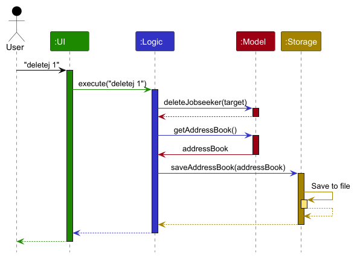

Each of the four main components (also shown in the diagram above),

* defines its *API* in an `interface` with the same name as the Component.
* provides its functionality through a concrete `{Component Name}Manager` class that implements the corresponding API interface.

For example, the `Logic` component defines its API in `Logic.java` and implements it in `LogicManager.java`. Other components interact with a component through its interface rather than its concrete class, preventing them from coupling to that component's implementation, as illustrated in the following partial class diagram.

The sections below give more details of each component.

### UI component

**API** : [`Ui.java`](https://github.com/AY2627S1-CS2103T-F10-4/tp/tree/master/src/main/java/seedu/address/ui/Ui.java)

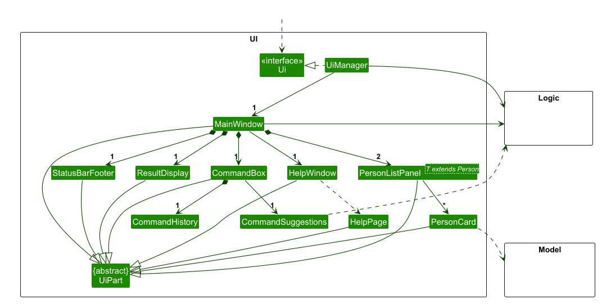

`UiManager` implements the `Ui` API. Its `start` method creates and shows the `MainWindow`, then has it fill in its parts. If this fails, `UiManager` shows a fatal error dialog and exits the app.

The UI consists of a `MainWindow` and its parts: a `CommandBox`, a `ResultDisplay`, a `StatusBarFooter`, and two `PersonListPanel`s (one for jobseekers and one for clients), each showing its contacts as `PersonCard`s. `MainWindow` also creates a `HelpWindow`, a separate window that displays one `HelpPage` at a time (`HelpPage` is a private nested class of `HelpWindow`, so it has no source file of its own). All of these, including `MainWindow`, inherit from the abstract `UiPart` class, which captures common behavior among classes that represent visible GUI parts.

`CommandBox` delegates recalling past commands to `CommandHistory` and completing command names to `CommandSuggestions`. Neither is a `UiPart`, because they hold no layout of their own. `CommandSuggestions` reads the command names from `CommandCatalogue` in the `Logic` component, so a new command is only suggested once it is added there. `CommandBox` itself has no reference to the `Logic` interface: it submits input through a `CommandExecutor` that `MainWindow` gives it. It still uses `CommandResult`, `CommandException` and `ParseException` from the `Logic` component because they appear in the signature of `CommandExecutor`, but the diagram omits this dependency for simplicity.

For simplicity, the diagram omits the custom JavaFX classes used by the help window: `ExampleCode` (a copyable command snippet in a help page), `SectionHyperlink` (a link to a help page, used in the help window's navigation list and inside help pages), and the `NavigationEvent` that a `SectionHyperlink` fires to ask `HelpWindow` to show that page.

A `SectionHyperlink` uses its own text as the page name, and `HelpPage` looks that name up in its `PAGES` map to find the page's `.fxml` file. The link text must therefore match a key in `PAGES` exactly; otherwise, clicking the link throws a `NullPointerException`. To add a help page, create its `HelpPage_*.fxml` file, add an entry to `PAGES`, and add a `SectionHyperlink` to `HelpWindow.fxml` or to another help page.

#### Help window interaction

When the user enters the `help` command, `MainWindow` receives a `CommandResult` requesting that the help window be shown. It displays `HelpWindow`, which loads the default help page. Users can navigate between sections using `SectionHyperlink`; each link fires a `NavigationEvent` that tells `HelpWindow` to display the selected page.

The following sequence diagram illustrates how the help window is opened:

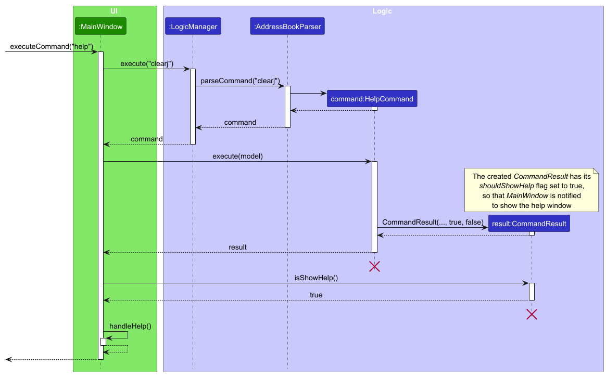

The `UI` component uses the JavaFX UI framework. The layouts of the `UiPart`s are defined in `.fxml` files in `src/main/resources/view`, usually named after the class. For example, [`MainWindow.fxml`](https://github.com/AY2627S1-CS2103T-F10-4/tp/tree/master/src/main/resources/view/MainWindow.fxml) specifies the layout of [`MainWindow`](https://github.com/AY2627S1-CS2103T-F10-4/tp/tree/master/src/main/java/seedu/address/ui/MainWindow.java). The exceptions are `PersonCard`, which uses `PersonListCard.fxml`, and `HelpPage`, which has one `HelpPage_*.fxml` file per page.

The `UI` component,

* uses the `Logic` component to execute user commands and to load and save the window's size and position (`GuiSettings`). `MainWindow` makes these calls; `UiManager` only keeps a reference to `Logic` so that it can pass it to `MainWindow`.
* acts on the `CommandResult` of each command: `MainWindow` shows the feedback in `ResultDisplay` and, when the result asks for it, opens the help window, exits the app, or copies text to the system clipboard.
* listens for changes to `Model` data through the `ObservableList`s that `Logic` exposes, so that each `PersonListPanel` updates with the modified data.
* depends on some classes in the `Model` component because it displays `Person` objects, including the fields specific to `Jobseeker` and `Client`.

### Logic component

**API** : [`Logic.java`](https://github.com/AY2627S1-CS2103T-F10-4/tp/tree/master/src/main/java/seedu/address/logic/Logic.java)

Here's a (partial) class diagram of the `Logic` component:

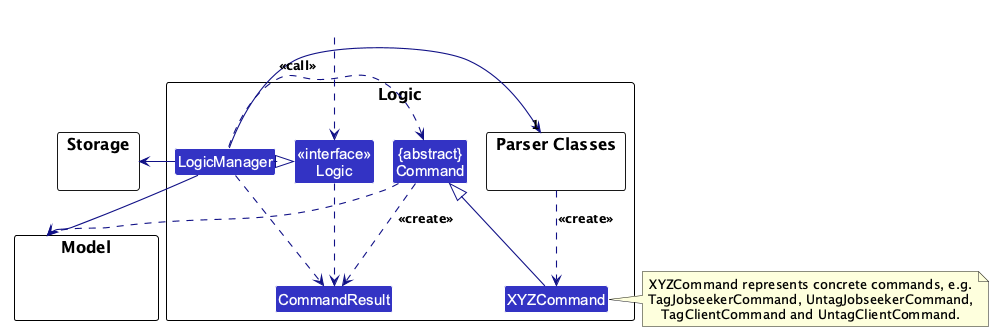

The sequence diagram below illustrates the interactions within the `Logic` component, taking `execute("deletec 1")` API call as an example.

How the `Logic` component works:

1. When `Logic` is called upon to execute a command, the command is passed to an `AddressBookParser` object, which in turn creates a parser that matches the command (e.g., `DeleteClientCommandParser`) and uses it to parse the command.
1. This results in a `Command` object (more precisely, an object of one of its subclasses e.g., `DeleteClientCommand`) which is executed by the `LogicManager`.
1. The command can communicate with the `Model` when it is executed (e.g. to delete a client). 
   As the diagram above shows, this can take several interactions between the command object and the `Model`.
1. The result of the command execution is encapsulated as a `CommandResult` object which is returned from `Logic`.

Here are the other classes in `Logic` (omitted from the class diagram above) that are used for parsing a user command:

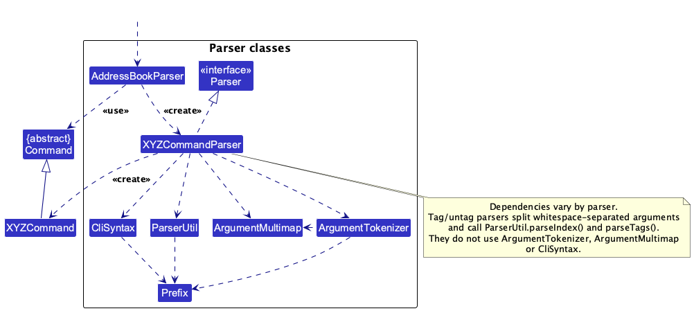

How the parsing works:
* When called upon to parse a user command, the `AddressBookParser` class creates an `XYZCommandParser` (`XYZ` is a placeholder for the specific command name, e.g., `AddJobseekerCommandParser`). The parser uses the other classes shown above to parse the user command and create an `XYZCommand` object (e.g., `AddJobseekerCommand`). The `AddressBookParser` returns that object as a `Command` object.
* All `XYZCommandParser` classes, such as `AddJobseekerCommandParser` and `TagJobseekerCommandParser`, implement the `Parser` interface so they can be treated similarly where appropriate, for example during testing.

* Parser dependencies vary by command. Tag/untag parsers split ASCII whitespace-separated arguments and use `ParserUtil.parseIndex()` and `ParserUtil.parseTags()` directly; they do not use `ArgumentTokenizer`, `ArgumentMultimap`, or `CliSyntax`.

### Model component
**API** : [`Model.java`](https://github.com/AY2627S1-CS2103T-F10-4/tp/tree/master/src/main/java/seedu/address/model/Model.java)

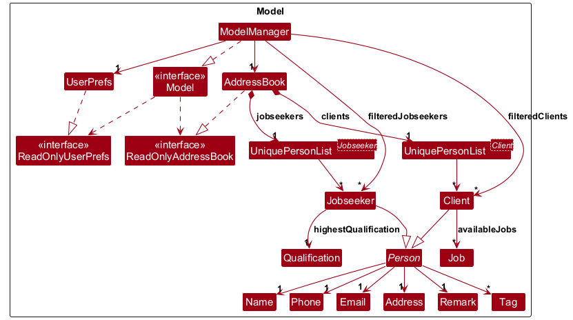

The `Model` component,

* stores jobseekers and clients in separate `UniquePersonList<Jobseeker>` and `UniquePersonList<Client>` collections. Both jobseeker and client extend the abstract `Person` class.
* exposes separate filtered `ObservableList<Jobseeker>` and `ObservableList<Client>` views that the UI observes.
* stores an optional highest qualification in each `Jobseeker` as a `Qualification` value object. An empty value means unspecified. Each `Client` stores an immutable `Set<Job>` of available jobs; an empty set means no jobs specified. These fields affect equality but do not change contact identity (phone and email).
* stores a `UserPrefs` object that represents the user’s preferences (currently, just the GUI settings). This is exposed to the outside as a `ReadOnlyUserPrefs` object.
* does not depend on any of the other three components (as the `Model` represents data entities of the domain, they should make sense on their own without depending on other components)

:information_source: **Note:** The alternative, arguably more object-oriented, design below keeps a unique list of tags in `AddressBook`, and each `Person` references tags from that list. This lets `AddressBook` maintain one `Tag` object per unique tag instead of each `Person` holding its own `Tag` objects. Only the classes relevant to tags are shown. 

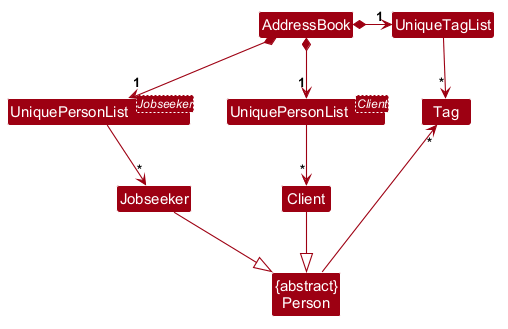

### Storage component

**API** : [`Storage.java`](https://github.com/AY2627S1-CS2103T-F10-4/tp/tree/master/src/main/java/seedu/address/storage/Storage.java)

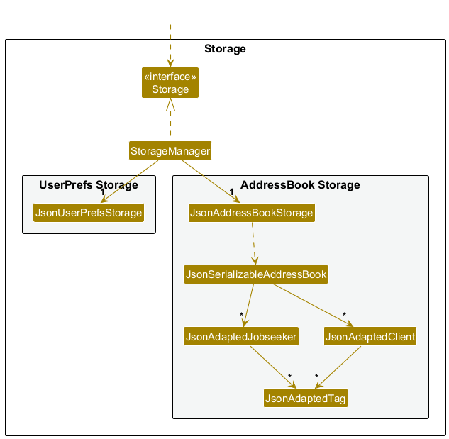

The `Storage` component,
* can save both address book data and user preference data in JSON format, and read them back into corresponding objects.
* is implemented by `StorageManager`, which delegates the actual JSON file access to `JsonAddressBookStorage` and `JsonUserPrefsStorage` (one class per data file).
* depends on some classes in the `Model` component (because the `Storage` component's job is to save/retrieve objects that belong to the `Model`)

`JsonAdaptedJobseeker` persists `highestQualification` as a string, and `JsonAdaptedClient` persists `availableJobs` as an array of job titles. Missing or null fields default to an empty qualification or job set, allowing older files to load. Blank or null entries inside the jobs array are rejected as invalid data.

### Common classes

Classes used by multiple components are in the `seedu.address.commons` package.

--------------------------------------------------------------------------------------------------------------------

## **Implementation**

This section describes some noteworthy details on how certain features are implemented.

### Edit jobseeker feature

The `editj` command updates a jobseeker identified by their one-based index in the currently displayed jobseeker list. `AddressBookParser` delegates to `EditCommandParser`, which creates an `EditJobseekerCommand` containing an `Index` and a defensive copy of an `EditJobseekerDescriptor`.

The following sequence diagram focuses on successful execution of `editj 1 n/Alice r/Available`. Local aliases `target` and `edited` represent the original and replacement jobseekers. Parsing, error paths, and storage details are explained below; `...` indicates omitted parameters.

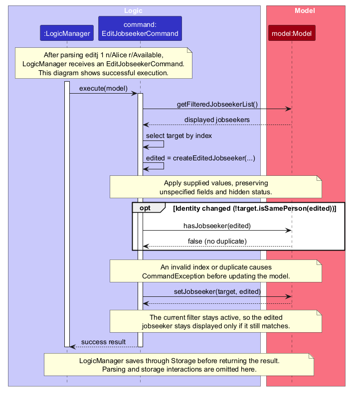

#### Parsing and optional fields

`EditCommandParser` tokenizes the arguments using `ArgumentTokenizer`, parses the index with `ParserUtil.parseIndex()`, and rejects repeated `n/`, `p/`, `e/`, `a/`, `r/`, or `q/` prefixes. It validates the supplied fields and populates `EditJobseekerDescriptor`. Invalid input or a descriptor with no supplied fields causes a `ParseException` before execution.

Unspecified fields remain unchanged. For remarks, an omitted `r/` leaves the descriptor's remark unset, while an empty `r/` supplies `new Remark("")` to clear the existing remark. Supplied tags replace the existing set; `t/` alone supplies an empty set to clear all tags.

Jobseeker qualifications follow the same omitted/empty distinction: `q/` supplies an empty `Qualification`, while omitting it preserves the current value. For clients, `EditClientCommandParser` accepts repeated `j/` prefixes and supplies a replacement `Set<Job>` to `EditClientDescriptor`. `j/` alone clears the set; blank entries mixed with other jobs are rejected. Hide, unhide, tag, and untag commands preserve these fields when constructing replacement contacts.

#### Execution, filtering, and persistence

1. `EditJobseekerCommand` reads `Model.getFilteredJobseekerList()` and rejects an index outside the displayed list with a `CommandException`.
2. `createEditedJobseeker()` combines supplied values with the original jobseeker's unchanged fields and preserves `isHidden()`.
3. If the edited jobseeker has a different identity according to `isSamePerson()`, the command calls `Model.hasJobseeker()` and rejects a duplicate before modifying the model.
4. The command calls `Model.setJobseeker()` and leaves the current filter unchanged. The edited jobseeker stays displayed only if it still matches that filter. For example, a jobseeker found by name alone drops out of the search results when renamed to a name that no longer matches, while an edited hidden jobseeker stays in the hidden list because `isHidden()` is preserved.
5. After the command returns, `LogicManager` saves the address book through `Storage`. Parsing or execution failures skip saving. If saving fails, `LogicManager` restores the address book data from before the command and reports the failure as a `CommandException`.

### Find feature

The find commands list the contacts that match at least one of the given keywords. Each command accepts `<keyword>...` and requires at least one keyword. The commands differ only in which contacts they search.

| Command | Command class | Parser class | Contacts searched |
| --- | --- | --- | --- |
| `find` | `FindCommand` | `FindCommandParser` | Unhidden jobseekers and unhidden clients |
| `findj` | `FindJobseekerCommand` | `FindJobseekerCommandParser` | Unhidden jobseekers |
| `findc` | `FindClientCommand` | `FindClientCommandParser` | Unhidden clients |
| `findhj` | `FindHiddenJobseekerCommand` | `FindHiddenJobseekerCommandParser` | Hidden jobseekers |
| `findhc` | `FindHiddenClientCommand` | `FindHiddenClientCommandParser` | Hidden clients |

#### Structure

The following class diagram shows how these classes relate. `FindXYZCommand` and `FindXYZCommandParser` are placeholders for any command and parser class in the table above. Only members relevant to shared find handling are shown.

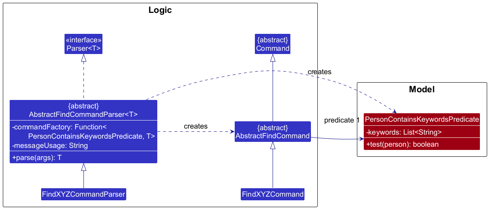

The five commands extend `AbstractFindCommand`, which stores the `PersonContainsKeywordsPredicate` and implements `equals()` and `toString()`. Each concrete command only implements `execute()`, which chooses the list(s) to filter and whether to search hidden or unhidden contacts. `equals()` compares classes using `getClass()` because `findj alice` and `findc alice` have equal predicates but search different lists, so they must not be equal.

The five parsers extend `AbstractFindCommandParser<T>`, which contains all of the parsing logic. Each concrete parser only passes its command's constructor (e.g., `FindJobseekerCommand::new`) and usage message to the superclass.

#### Parsing and execution

The following sequence diagram shows the find-specific part of how `findj bob` is parsed and executed. `LogicManager`, `AddressBookParser` and `CommandResult` work as shown for `deletec 1` in the [`Logic` component](#logic-component), so they are omitted: arrows at the left edge of the diagram lead to or from `AddressBookParser` and `LogicManager`. The `...` argument of `updateFilteredJobseekerList(...)` is the combined predicate described in step 4 below. Storage interactions are also omitted.

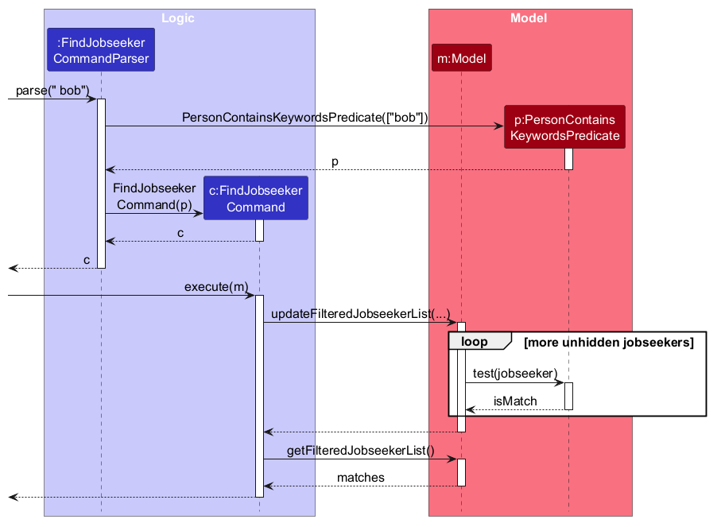

1. `AddressBookParser` selects `FindJobseekerCommandParser` using the command word and calls `parse()`, which the parser inherits from `AbstractFindCommandParser`.
2. `parse()` removes leading and trailing whitespace with `String#strip()` and splits the rest on `\p{javaWhitespace}+`. If no keywords remain, it throws a `ParseException` containing the command's usage message.
3. `parse()` wraps the keywords in a `PersonContainsKeywordsPredicate` and passes it to `commandFactory`, which creates the command.
4. `LogicManager` calls the command's `execute(model)` method. The command combines `Model.PREDICATE_SHOW_UNHIDDEN_JOBSEEKERS` with the keyword predicate using `Predicate#and()` and passes the result to `Model#updateFilteredJobseekerList()`.
5. The `FilteredList` in `ModelManager` tests each jobseeker against the combined predicate. `and()` does not evaluate the keyword predicate for a hidden jobseeker, as the first predicate is already false.
6. The command counts the jobseekers left in the filtered list and returns a `CommandResult` reporting that number.

The other commands follow the same flow. `findc` uses `PREDICATE_SHOW_UNHIDDEN_CLIENTS` and `updateFilteredClientList()`, while `findhj` and `findhc` use `PREDICATE_SHOW_HIDDEN_JOBSEEKERS` and `PREDICATE_SHOW_HIDDEN_CLIENTS` in place of the unhidden predicates. `find` updates both lists, which has the same effect as running `findj` followed by `findc`. One predicate can filter both lists because `PersonContainsKeywordsPredicate` implements `Predicate<Person>`, and `Jobseeker` and `Client` both extend `Person`.

Find commands have no prefixes, so the parsers do not use `ArgumentTokenizer`: `n/Alice` is a literal keyword rather than a search by name. `String#strip()` and `\\p{javaWhitespace}` recognise Java whitespace characters, including EM SPACE (`U+2003`). The shared tag parser uses ASCII whitespace separators instead. However, `AddressBookParser` replaces EM SPACE with an ordinary space before dispatching arguments, so EM SPACE also separates tags in commands entered through the application.

#### Keyword matching

`PersonContainsKeywordsPredicate#test()` returns true if any keyword appears in any searchable field of the contact, ignoring case. The searchable fields are:

* the name, phone number, email and each tag of any contact
* the highest qualification of a jobseeker
* each job opening of a client

Addresses and remarks are not searched. The following details affect which contacts match:

* Keywords match partial words because the predicate uses `String#contains()`. For example, `9435` matches the phone number `94351253`.
* Each field is checked on its own, so a keyword cannot match across two fields, two tags or two job openings. For example, `Yeoh8743` does not match a jobseeker named `Alex Yeoh` whose phone number is `87438807`.
* Text is lowercased using `Locale.ROOT` so that results do not depend on the computer's locale. Under a Turkish locale, for example, `ALICE` would otherwise become `alıce` and would not match `alice`.

#### Filtering and persistence

A find command replaces the filter of the list(s) it searches and does not modify any contact. `findj` and `findhj` leave the client list's filter unchanged, and `findc` and `findhc` leave the jobseeker list's filter unchanged. Each `PersonListPanel` observes its filtered list, so the displayed results update as soon as the filter changes.

Only find and list commands change a filter, so a search stays active until the next such command on that list. While it is active, other commands resolve indices against the search results, and a contact that is added or edited appears in the list only if it matches the filter.

Filters are held only in memory by `ModelManager`. `LogicManager` saves the address book after a find command, as it does after any successful command, but filters are not part of the saved data. The app therefore shows the unhidden contacts of each type on the next launch.

#### Design considerations:

**Aspect: How the five find commands share code:**

* **Alternative 1 (current choice):** One command class and one parser class per command word, with shared logic in abstract superclasses.
  * Pros: Follows the one-parser-per-command structure of the other commands. Each `execute()` is short, with no branching on which contacts to search.
  * Cons: Adds ten small classes, and the `execute()` methods are similar to one another.

* **Alternative 2:** One command class and one parser class, with a parameter that selects the contacts to search.
  * Pros: Fewer classes.
  * Cons: `execute()` must branch on that parameter, and the parser no longer follows the structure of the other commands' parsers.

**Aspect: How a keyword matches a field:**

* **Alternative 1 (current choice):** Case-insensitive substring match.
  * Pros: Recruiters can search with part of a phone number, email or job title.
  * Cons: Short keywords can return unrelated contacts. For example, `li` matches `Charlotte Oliveiro`.

* **Alternative 2:** Case-insensitive whole-word match, using `StringUtil.containsWordIgnoreCase()`.
  * Pros: Fewer unrelated results.
  * Cons: Partial phone numbers and emails no longer match. For example, `9435` would not match `94351253`.

### Hide/Unhide feature

The hide and unhide commands set whether a jobseeker or client is hidden. A hidden contact stays in the address book, but only `listhj`, `listhc`, `findhj` and `findhc` display it. Each command accepts `<index>`, the contact's one-based index in the currently displayed list.

| Command | Command class | Parser class |
| --- | --- | --- |
| `hidej` | `HideJobseekerCommand` | `HideJobseekerCommandParser` |
| `hidec` | `HideClientCommand` | `HideClientCommandParser` |
| `unhidej` | `UnhideJobseekerCommand` | `UnhideJobseekerCommandParser` |
| `unhidec` | `UnhideClientCommand` | `UnhideClientCommandParser` |

#### Structure

The hidden status is the `isHidden` field of `Person`, which `Jobseeker` and `Client` inherit. The following class diagram shows how the command classes relate. Only members relevant to shared hide handling are shown.

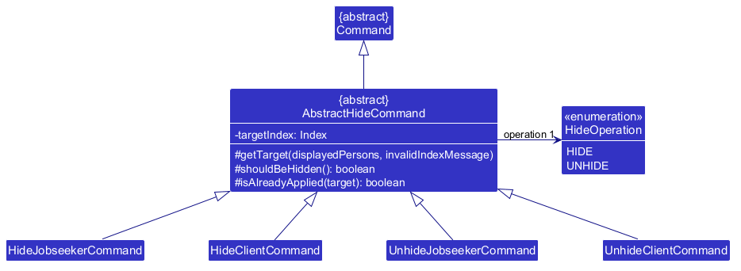

The four commands extend `AbstractHideCommand`, which stores the target `Index` and a `HideOperation`. It provides three helpers:

* `getTarget()` resolves the index against a displayed list, throwing a `CommandException` if the index is outside that list.
* `shouldBeHidden()` returns the hidden status that the operation gives a contact: `true` for `HIDE` and `false` for `UNHIDE`.
* `isAlreadyApplied()` returns true if a contact already has that status.

Each concrete command passes its operation to the superclass and implements `execute()`, which chooses the list to read, creates the replacement contact and passes it to the `Model`. `AbstractHideCommand#equals()` compares classes using `getClass()` because `hidej 1` and `hidec 1` have equal indices but act on different lists, so they must not be equal.

#### Parsing and execution

Parsing follows the flow shown for `deletec 1` in the [`Logic` component](#logic-component). `AddressBookParser` selects the parser using the command word, and `parse()` calls `ParserUtil.parseIndex()` and creates the command with the resulting `Index`. If the argument is not a single positive integer that fits in an `int`, `parse()` throws a `ParseException` containing the command's usage message. Each parser implements `Parser<T>` directly, as `parse()` is only these two steps, so there is no shared parser superclass like those of the find and tag parsers.

The following sequence diagram shows how `hidej 1` is executed. `LogicManager` and `CommandResult` work as shown for `deletec 1`, so they are omitted: arrows at the left edge of the diagram lead to or from `LogicManager`. The `...` in `getTarget(displayed, ...)` is the invalid-index message. In `Jobseeker(..., true)`, the `...` is the target's other fields and `true` is the result of `shouldBeHidden()`. Storage interactions are also omitted.

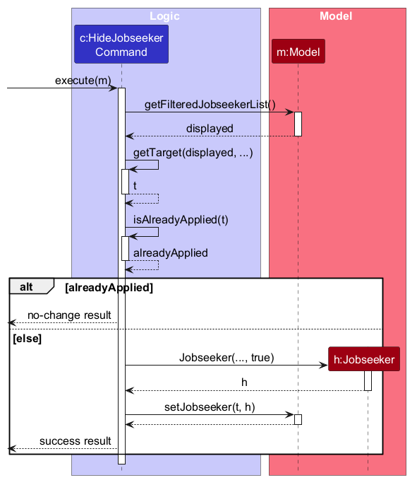

1. `LogicManager` calls the command's `execute(m)` method. The command gets the displayed jobseeker list from the `Model`, and the inherited `getTarget()` returns the target jobseeker `t`.
2. The inherited `isAlreadyApplied()` compares `t.isHidden()` with `shouldBeHidden()`. If they are equal, the command returns `MESSAGE_NO_CHANGE` without modifying the model. This is not an error.
3. Otherwise, the command creates a replacement jobseeker `h`. It copies all of the target's fields except the hidden status, which comes from `shouldBeHidden()`. A replacement is needed because `Person` objects are immutable.
4. `Model#setJobseeker()` replaces `t` with `h` in the address book's `UniquePersonList`. The `FilteredList` in `ModelManager` observes that list, so it tests `h` against its current predicate. `h` fails the predicate and leaves the displayed list.
5. The command returns a `CommandResult` containing the success message.

The other commands follow the same flow. `hidec` and `unhidec` use `getFilteredClientList()`, a replacement `Client` and `setClient()`. `unhidej` and `unhidec` use the `UNHIDE` operation, so `shouldBeHidden()` returns `false`.

#### Filtering and persistence

Hide and unhide commands do not change a filter. Only find and list commands do, and each builds its filter on one of the four hidden-status predicates in `Model`, such as `PREDICATE_SHOW_UNHIDDEN_JOBSEEKERS`. A displayed list therefore contains either only unhidden contacts or only hidden contacts, which decides what the commands do to a displayed contact:

| Displayed list | `hidej`/`hidec` | `unhidej`/`unhidec` |
| --- | --- | --- |
| Unhidden contacts, e.g. on launch or after `listj` or `findc` | Hides the contact, which leaves the displayed list | No change |
| Hidden contacts, e.g. after `listhj` or `findhc` | No change | Unhides the contact, which leaves the displayed list |

When a contact leaves the displayed list, the contacts below it move up, so their indices decrease by one. `PersonCard` shows a "Hidden" badge when `isHidden()` is true, so the badge appears only in hidden lists.

After a command returns normally, including a no-change result, `LogicManager` saves the address book through `Storage`. `JsonAdaptedJobseeker` and `JsonAdaptedClient` save the status under the JSON key `hidden`. A missing or null value loads as unhidden, so save files written before this feature existed still load. Filters are not saved, so the app shows the unhidden contacts of each type on the next launch, and hidden contacts stay hidden.

### Tag/Untag feature

The tag/untag commands add or remove tags for a jobseeker or client identified by their one-based index in the currently displayed list. Each command accepts `INDEX TAG [MORE_TAGS]...` and requires at least one tag.

| Command | Command class | Parser class |
| --- | --- | --- |
| `tagj` | `TagJobseekerCommand` | `TagJobseekerCommandParser` |
| `untagj` | `UntagJobseekerCommand` | `UntagJobseekerCommandParser` |
| `tagc` | `TagClientCommand` | `TagClientCommandParser` |
| `untagc` | `UntagClientCommand` | `UntagClientCommandParser` |

#### Structure and parsing

The following diagrams separate the command and parser hierarchies. Only members relevant to shared tag handling are shown.

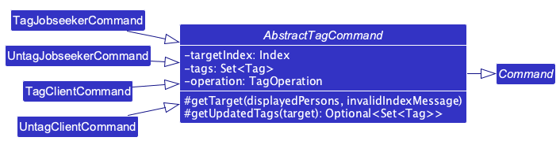

The four concrete commands extend `AbstractTagCommand`, which extends `Command`. It stores the target `Index`, a defensive copy of the requested tags, and the `ADD` or `REMOVE` operation. It also provides shared target lookup and tag-set updates; the concrete commands construct and save the replacement jobseeker or client.

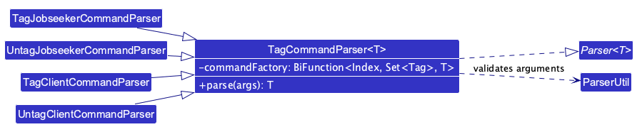

The four concrete parsers extend `TagCommandParser<T>`, which implements `Parser<T>`. `AddressBookParser` selects a concrete parser using the command word. The shared parser splits the arguments into an index and tag names, validates them using `ParserUtil.parseIndex()` and `ParserUtil.parseTags()`, and creates the corresponding command through its supplied command factory. Missing or invalid arguments cause a `ParseException` before execution.

`TagCommandParser` splits arguments using Java's default `\\s+`, which recognises ASCII whitespace. Before arguments reach this parser, `AddressBookParser` replaces EM SPACE (`U+2003`) with an ordinary space (`U+0020`). Consequently, `tagj 1 java python` (with an EM SPACE between the tag names) adds two tags through the application. Calling `TagCommandParser` directly without this preprocessing rejects the same tag arguments. Other Unicode spaces are not normalised by `AddressBookParser` and are not recognised as separators by `TagCommandParser`.

Tag names must contain only ASCII letters and digits. `Tag.equals()` compares names case-sensitively, so `Java` and `java` are distinct tags for both addition and removal. Parsed tags are collected into a `Set<Tag>`, collapsing repeated identical inputs.

#### Execution

All four commands follow the same flow:

1. `LogicManager` calls the command's `execute(model)` method.
2. The command uses the inherited `getTarget()` helper to resolve the index against the corresponding filtered list. An index outside that list causes a `CommandException`.
3. The inherited `getUpdatedTags()` helper copies the target's tags into a `HashSet` and applies the requested operation:

   | Operation | Set operation | No-change condition |
   | --- | --- | --- |
   | Add | `addAll(tags)` | All requested tags already exist |
   | Remove | `removeAll(tags)` | None of the requested tags exist |

4. If the operation has no effect, the command returns `MESSAGE_NO_CHANGE` without replacing the contact.
5. Otherwise, the concrete command creates a replacement contact with the updated tags, calls `Model.setJobseeker()` or `Model.setClient()`, and returns a success `CommandResult` describing the updated contact.

`getUpdatedTags()` returns `Optional.empty()` when there is no change. An optional containing an empty set instead means that all tags were successfully removed, so the contact must still be replaced.

The first sequence diagram shows execution of `tagj 1 java`, assuming a valid displayed index. The self-calls to `getTarget()` and `getUpdatedTags()` use methods inherited from `AbstractTagCommand`. The `...` in `getTarget()` omits the invalid-index message, while the constructor's `...` represents unchanged non-tag fields. Result construction and message formatting are omitted.

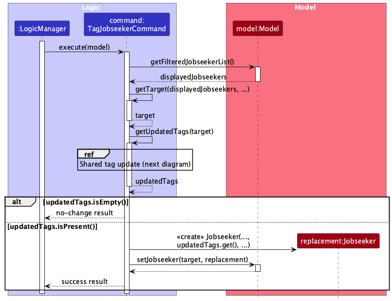

The referenced interaction below expands `getUpdatedTags()` for either operation. The `command` lifeline represents an instance of any concrete tag/untag command, viewed through its shared superclass; the call is the inherited self-call shown above, not a separate command object.

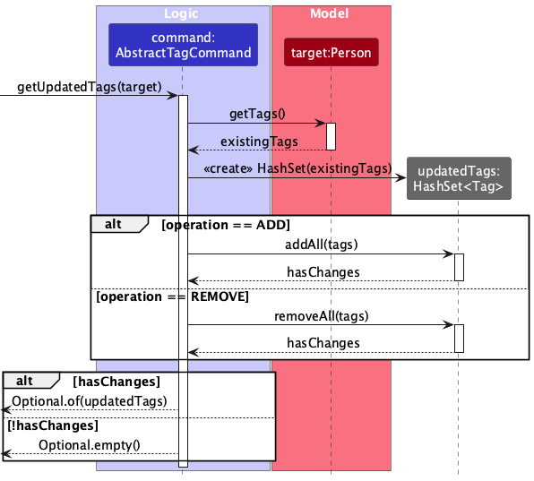

`UntagJobseekerCommand` follows the same execution flow with the `REMOVE` operation. The client commands use `Model.getFilteredClientList()`, a replacement `Client`, and `Model.setClient()` in place of their jobseeker equivalents. Parsing and invalid-index error paths are described above rather than repeated in the diagrams.

#### Filtering and persistence

All four commands preserve all non-tag fields, including highest qualification for jobseekers, available jobs for clients, and hidden status. Tagging or untagging a hidden contact does not unhide them.

The current filter remains active, and indices refer to the displayed list, including search results or a hidden-contact list. A contact remains visible only if it still matches that filter; for example, removing a tag can make it disappear from search results that matched that tag.

After a command returns normally, including a no-change result, `LogicManager` saves the address book through `Storage`. Parsing and execution errors propagate without reaching that save step. Storage interactions are omitted from the sequence diagrams to focus on command execution and tag updates.

### Clear feature

The `clearj` and `clearc` commands remove all jobseekers or clients respectively. They clear the selected contact list, including contacts hidden by the current filter, while leaving contacts of the other type unchanged. Since these commands do not take any arguments, they do not require dedicated parser classes.

| Command | Command class |
| --- | --- |
| `clearj` | `ClearJobseekerCommand` |
| `clearc` | `ClearClientCommand` |

The following sequence diagrams illustrate the execution of the clear commands:

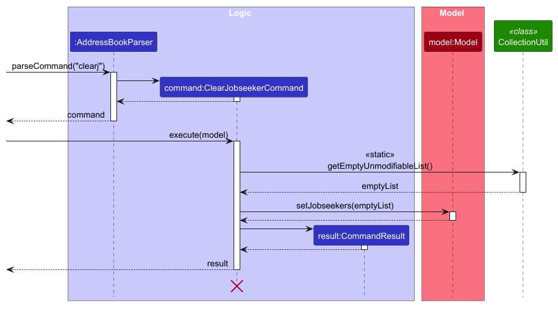

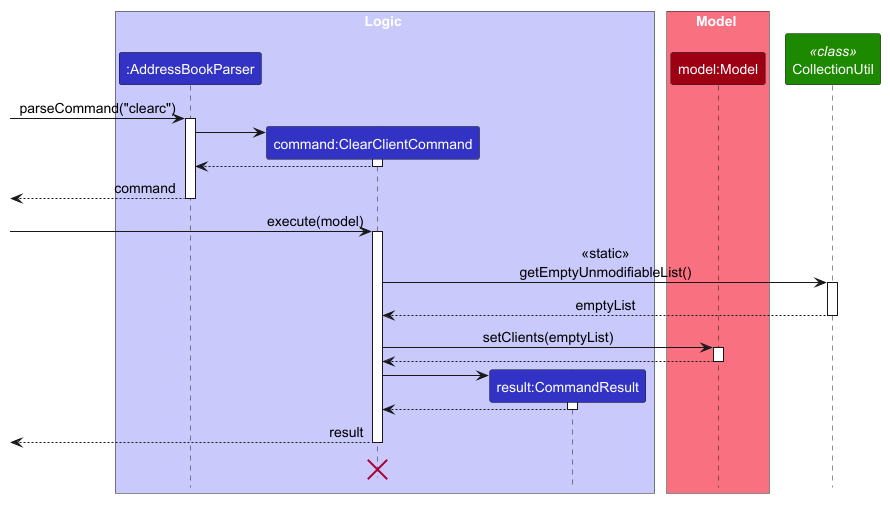

### Clipboard feature

The `cpc` and `cpj` commands copy client and jobseeker details to the system clipboard.

| Command | Command class | Parser class |
| --- | --- | --- |
| `cpc` | `CopyClientCommand` | `CopyClientCommandParser` |
| `cpj` | `CopyJobseekerCommand` | `CopyJobseekerCommandParser` |

Without an index, the command copies all persons in the corresponding currently displayed list. With an index, it copies only the indexed person. The index is one-based and refers to the filtered displayed list; an index outside the displayed list causes a `CommandException`.

The command formats and returns the clipboard text as part of `CommandResult`. `MainWindow` performs the actual system clipboard update in response to a non-null `CommandResult.getClipboardText()`.

Given below is an example usage scenario of an indexed client copy-to-clipboard command.

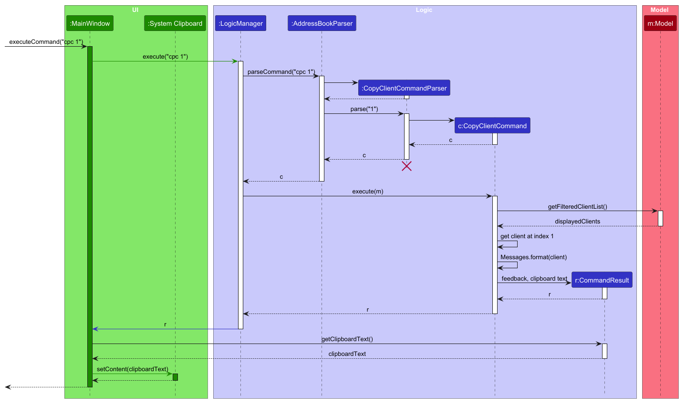

### \[Proposed\] Undo/redo feature

#### Proposed Implementation

The proposed `undo` and `redo` commands are not implemented yet. They would reverse and reapply changes to the contact data, using a `VersionedAddressBook` that extends `AddressBook` with an undo/redo history. The history is stored internally as an `addressBookStateList` and a `currentStatePointer`, and is changed by the following operations:

* `VersionedAddressBook#commit()` — Saves the current address book data as a new state, unless the data already matches the state at `currentStatePointer`.
* `VersionedAddressBook#undo()` — Restores the previous address book state from its history.
* `VersionedAddressBook#redo()` — Restores a previously undone address book state from its history.

These operations are exposed in the `Model` interface as `Model#commitAddressBook()`, `Model#undoAddressBook()` and `Model#redoAddressBook()` respectively. `Model#canUndoAddressBook()` and `Model#canRedoAddressBook()` report whether there is a state to move to. `Model#getCurrentStatePointer()` and `Model#setCurrentStatePointer()` let `LogicManager` put the pointer back after a failed save.

The feature would change five existing parts of the app:

* `ModelManager` holds a `VersionedAddressBook` in place of its `AddressBook`. Its filtered lists are built once from this object, so `undo()` and `redo()` update it in place with `resetData()` rather than replacing it.
* `Model` gains the methods above, so `ModelStub` in `AddJobseekerCommandTest` must implement them too.
* `LogicManager#execute()` calls `Model#commitAddressBook()` after each successful save. Individual commands do not commit.
* `AddressBookParser` gains `undo` and `redo`. So does `CommandCatalogue`, which lists the command names offered for completion, as its class comment asks for the two to be kept in sync.

Given below is an example usage scenario and how the undo/redo mechanism behaves at each step. The object diagrams show the contents of `addressBookStateList`: each object is a saved state, and the note marks the state at `currentStatePointer`.

Step 1. The user launches the application. The `VersionedAddressBook` is initialized with the app's initial address book data as its only state, and `currentStatePointer` points to that state. The history is held only in memory, so it starts afresh on every launch.

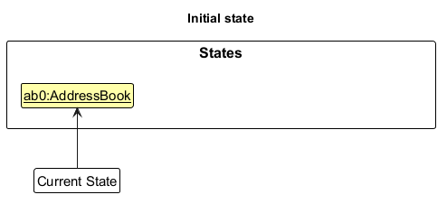

Step 2. The user executes `deletej 5` to delete the 5th jobseeker in the displayed jobseeker list. After saving, `LogicManager` calls `Model#commitAddressBook()`. The data now differs from the current state, so it is added to `addressBookStateList`, and `currentStatePointer` moves to this new state.

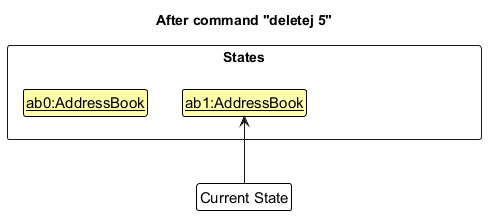

Step 3. The user executes `addj n/David …​` to add a new jobseeker. `LogicManager` again calls `Model#commitAddressBook()`, which adds another state to `addressBookStateList`.

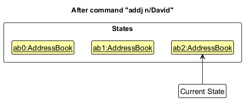

:information_source: **Note:** If parsing, execution or saving fails, `LogicManager` never reaches `Model#commitAddressBook()`, so no state is added to `addressBookStateList`.

Step 4. The user now decides that adding the jobseeker was a mistake, and executes the `undo` command. The command calls `Model#undoAddressBook()`, which moves `currentStatePointer` one state to the left and restores the address book to that state. `LogicManager` then saves the restored data as it does after any command, so the undo is also written to the save file. `LogicManager`'s call to `Model#commitAddressBook()` has no effect, because the data matches the current state.

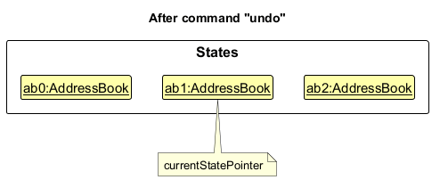

:information_source: **Note:** If `currentStatePointer` is at index 0, there are no previous states to restore. The `undo` command uses `Model#canUndoAddressBook()` to check for this, and throws a `CommandException` rather than attempting the undo.

The following sequence diagram shows how a successful undo goes through the `Logic` component:

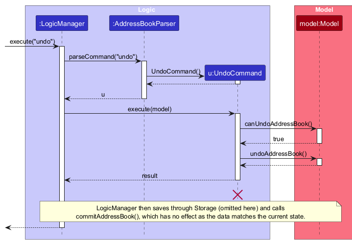

Similarly, how an undo goes through the `Model` component is shown below:

The `redo` command does the opposite: it calls `Model#redoAddressBook()`, which moves `currentStatePointer` one state to the right and restores the address book to that state.

:information_source: **Note:** If `currentStatePointer` is at index `addressBookStateList.size() - 1`, there are no undone states to restore. The `redo` command uses `Model#canRedoAddressBook()` to check for this, and throws a `CommandException` rather than attempting the redo.

Step 5. The user then executes `listj`. This command does not change the contact data, so the call to `Model#commitAddressBook()` has no effect, and `addressBookStateList` and `currentStatePointer` remain unchanged. The same applies to find and copy commands, and to commands that return a no-change result, such as tagging a jobseeker with a tag they already have. A command that reports success without changing the data, such as `clearj` on an empty list, also adds no state, so a following `undo` reverses the last actual change.

Step 6. The user executes `clearj`. The data now differs from the current state, and `currentStatePointer` is not at the end of `addressBookStateList`, so `Model#commitAddressBook()` purges all states after the pointer before adding the new one. It no longer makes sense to redo the `addj n/David …​` command, and most modern desktop applications behave the same way.

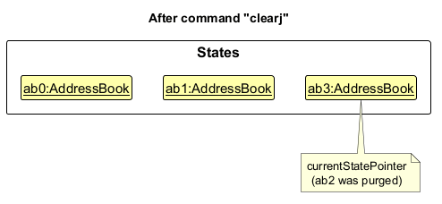

The following activity diagram summarizes what happens when a user executes a new command:

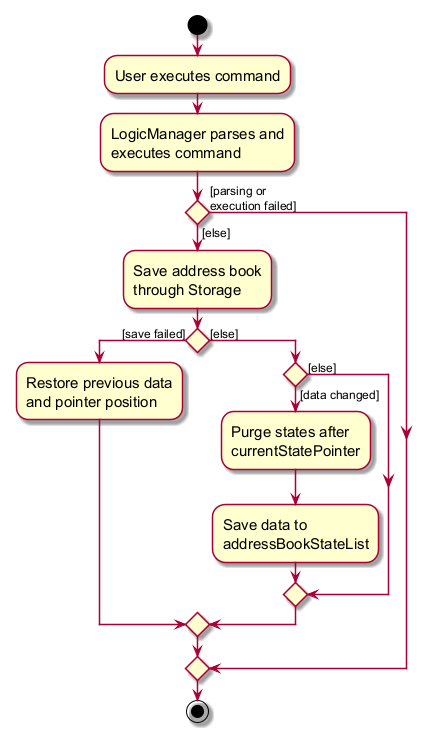

#### Filtering and persistence

Filters are not part of the address book data, so `undo` and `redo` leave the active filters and their descriptions unchanged. A restored contact therefore appears only if it matches the current filter, as with the `editj` command. For example, undoing `deletej` during a search restores the jobseeker to the data, but if they do not match the search, the jobseeker stays out of view until a find or list command changes the filter.

If saving fails, `LogicManager` already restores the data from before the command through `Model#setAddressBook()`. That call does not change the history, which is enough for most commands because they have not committed yet. `undo` and `redo` are the exception, as they have already moved `currentStatePointer`. `LogicManager` must therefore also call `Model#getCurrentStatePointer()` before executing a command, and pass the result to `Model#setCurrentStatePointer()` when a save fails, or the pointer and the data would no longer match.

#### Design considerations:

**Aspect: How undo & redo execute:**

* **Alternative 1 (proposed choice):** Save the entire address book as a state.
  * Pros: Easy to implement, and later commands that change data need no undo logic of their own.
  * Cons: Uses more memory as the contact lists grow and as each change adds a state, since the history has no size limit. The cost is limited because states can share `Person` objects, which are immutable, and copy only the two lists.

* **Alternative 2:** Each command knows how to undo and redo itself.
  * Pros: Uses less memory (e.g. for `deletej`, just save the jobseeker being deleted).
  * Cons: All 16 commands that change data need correct undo and redo logic, and each new one adds to this.

**Aspect: Where the state is committed:**

* **Alternative 1 (proposed choice):** `LogicManager` commits after each successful save, and `commit()` ignores data that matches the current state.
  * Pros: Needs one call only. Failed saves, read-only commands, no-change results, `undo` and `redo` all add no state, without any command having to handle them.
  * Cons: Compares the address book data after every command, including read-only ones.

* **Alternative 2:** Each command that changes data calls `Model#commitAddressBook()` itself.
  * Pros: Which commands can be undone is explicit in each command's code.
  * Cons: Commands run before the save, so a failed save would leave a state in the history for data that was rolled back. Each of the 16 commands must also remember the call, and the 8 tag, untag, hide and unhide commands must skip it on a no-change result.

**Aspect: How jobseeker and client changes share a history:**

* **Alternative 1 (proposed choice):** One history and one `undo` command, covering both lists.
  * Pros: Matches what the user expects, as `undo` always reverses the latest change. A state already holds both lists.
  * Cons: Undoing an older jobseeker change also undoes any later client changes.

* **Alternative 2:** Separate histories, with `undoj` and `undoc` commands.
  * Pros: Follows the naming of the other commands, and each list can be undone independently.
  * Cons: Needs two histories, and the user must remember which list they changed last.

--------------------------------------------------------------------------------------------------------------------

## **Documentation, logging, testing, dev-ops**

* [Documentation guide](Documentation.md)
* [Testing guide](Testing.md)
* [Logging guide](Logging.md)
* [DevOps guide](DevOps.md)

--------------------------------------------------------------------------------------------------------------------

## **Appendix: Requirements**

### Product scope

**Target user profile**:

* is a HR recruiter in a recruitment agency
* has to keep track of many potential jobseekers and clients (prospective employers)
* has to interview and shortlist jobseekers, and match jobseekers to clients
* prefers desktop apps over other types of applications
* can type fast
* prefers typing to mouse interactions
* is reasonably comfortable using CLI apps

**Value proposition**: TalentLink provides a much faster way for HR Recruiters in recruitment agencies to manage their contacts list (jobseekers + clients), compared to a typical mouse-driven GUI application. 
TalentLink helps these recruiters with daily tasks such as recording notes on each jobseeker/client, searching for jobseekers with specified educational qualifications, and determining which jobseeker to match with which client/which job opening.

### User stories

Priorities: High (must have) - `* * *`, Medium (nice to have) - `* *`, Low (unlikely to have) - `*`

| Priority | As a …​                                      | I want to …​                                                                     | So that I can…​                                                                                                 |
|----------|----------------------------------------------|----------------------------------------------------------------------------------|-----------------------------------------------------------------------------------------------------------------|
| `* * *`  | new user                                     | explore the app with sample data                                                 | gain a quick overview and understanding of the App                                                              |
| `* * *`  | new user                                     | see usage instructions                                                           | understand how to use the App                                                                                   |
| `* * *`  | user                                         | add a new jobseeker/client                                                       |                                                                                                                 |
| `* * *`  | user                                         | delete a jobseeker/client                                                        | remove contacts that I no longer need                                                                           |
| `* * *`  | user                                         | archive/unarchive a jobseeker/client                                             | remove contacts that I likely no longer need from the main contact list, and retrieve them again if I need them |
| `* * *`  | user                                         | display all the jobseekers/clients in the list                                   |                                                                                                                 |
| `* * *`  | user                                         | display all the archived jobseekers/clients in the list                          |                                                                                                                 |
| `* * *`  | user with many contacts in the App           | tag jobseekers/clients by keywords                                               | categorise them                                                                                                 |
| `* * *`  | user with many contacts in the App           | find jobseekers/clients by name/keywords/tags                                    | locate details of jobseekers/clients without having to go through the entire list                               |
| `* * *`  | user                                         | record the details of each jobseeker/client (e.g. contact info)                  |                                                                                                                 |
| `* * *`  | user                                         | record the job vacancies associated with each client                             | keep track of the job vacancies which I need to fill up                                                         |
| `* * *`  | user                                         | attach personal notes to jobseekers/clients                                      | remember additional details about them                                                                          |
| `* * *`  | user                                         | edit details of my jobseekers/clients with ease                                  | update my jobseekers/clients' details if there are any changes                                                  |
| `* * *`  | user with multiple contacts in the App       | match jobseekers to clients' job postings and record it within the app           |                                                                                                                 |
| `* * *`  | user with multiple contacts in the App       | record down the job postings that each jobseeker has given explicit consent to   | avoid accidentally sending my jobseekers' details to my clients without their explicit permission               |
| `* *`    | intermediate user                            | see summarised usage instructions                                                | quickly refresh my memory when I forget how to use the App                                                      |
| `* *`    | user with many archived contacts             | delete all the archived contacts from the app                                    | remove unwanted clutter in the App if I do not need the information anymore                                     |
| `* *`    | user with multiple contacts in the App       | delete all the contacts from the app                                             | reset the data                                                                                                  |
| `* *`    | user with many contacts in the App           | sort jobseekers/clients by name/tags/industry/skills/qualifications              | locate certain types of jobseekers/clients more easily                                                          |
| `* *`    | user                                         | rank jobseekers according to skills/qualifications                               | determine which jobseeker to interview next and send to my client                                               |
| `* *`    | user with multiple jobseekers in the App     | schedule and record interview timings within the app                             | easily keep track of the upcoming interviews that I have with my jobseekers                                     |
| `* *`    | user with multiple jobseekers in the App     | record interview notes of jobseekers                                             | retrieve and refer to the interview notes later when I need it                                                  |
| `* *`    | user                                         | copy the details of all displayed or one selected client to the clipboard        | send the client/job vacancy's details to my jobseekers                                                          |
| `* *`    | user                                         | copy the details of all displayed or one selected jobseeker to the clipboard     | send the shortlisted jobseekers' details to my clients                                                          |
| `* *`    | user                                         | receive alerts when adding a jobseeker/client that potentially already exists    | avoid creating duplicate jobseekers/clients                                                                     |
| `* *`    | user                                         | undo the previous action                                                         | undo an accidental action that I made                                                                           |
| `* *`    | user                                         | access and modify the previous command                                           | rerun the previous command but with slight modifications, after undoing an accidental action                    |
| `* *`    | user                                         | filter jobseekers according to the types of jobs they want to apply for          | determine which jobseeker to interview/send to my client next for a particular job posting                      |
| `* *`    | user                                         | customise the colours of my jobseekers/clients by tag                            | spot relevant jobseekers/clients easily when scrolling                                                          |
| `* *`    | expert user                                  | perform frequently used commands instantly                                       | save time from having to type out the entire command                                                            |
| `* *`    | expert user                                  | autocomplete my current command based on the app's recommendations               | save time from having to type out the entire command                                                            |
| `*`      | frequent user                                | customise the layouts of my contacts                                             | scroll through my contacts more efficiently                                                                     |
| `*`      | user                                         | store and export my jobseekers' resumes within the App                           | send my jobseekers' resumes to my clients easily                                                                |
| `*`      | user                                         | determine which jobseekers have given consent to apply to a specified job        | compare between jobseekers and determine which one to send to my client                                         |
| `*`      | user working with many clients               | flag/rank clients based on urgency of job postings                               | determine which client to prioritise                                                                            |
| `*`      | expert user                                  | modify the keywords of commands                                                  | easier to remember and faster to type                                                                           |
| `*`      | expert user                                  | chain, select and modify commands                                                | avoid having to type the same commands over and over again                                                      |
| `*`      | expert user                                  | access the most commonly viewed jobseekers/clients (within a recent time period) | work more efficiently, since I would more likely need a contact that I viewed/was working on recently           |

### Use cases

For all use cases below, the **System** is **TalentLink** and the **Actor** is the **recruiter**.
A contact is a jobseeker or a client.

**Use case: UC01 - List contacts**

**MSS**

1. Recruiter requests to list unhidden jobseekers, unhidden clients, both unhidden contact types, or hidden contacts of one type.
2. TalentLink displays all contacts in the requested scope and confirms that the list has been displayed.

Use case ends.

**Extensions**

* 2a. No contacts exist in the requested scope.

    * 2a1. TalentLink displays an empty list for that scope.

      Use case ends.

**Use case: UC02 - Add a contact**

**MSS**

1. Recruiter requests to add a contact, providing its details and specifying whether it is a jobseeker or a client.
2. TalentLink adds the contact and confirms the addition.

Use case ends.

**Extensions**

* 1a. A contact of the selected type already exists with the same phone number and email address.

    * 1a1. TalentLink informs the recruiter of the duplicate without adding a contact.

      Use case ends.

* 1b. Required details are missing, or supplied details are invalid.

    * 1b1. TalentLink explains the input error without adding a contact.

      Use case ends.

**Use case: UC03 - Delete a contact**

**MSS**

1. Recruiter requests to <u>list contacts (UC01)</u>, or <u>search for contacts (UC04)</u>.
2. TalentLink displays the contacts in the requested scope.
3. Recruiter identifies a displayed contact and requests its deletion.
4. TalentLink deletes the contact and confirms the deletion.

Use case ends.

**Extensions**

* 2a. No contacts are displayed.

    * 2a1. TalentLink displays an empty result; there is no contact to select.

      Use case ends.

* 3a. The contact selected is missing, invalid, or outside the displayed results.

    * 3a1. TalentLink informs the recruiter of the invalid selection without changing any contact.

      Use case ends.

**Use case: UC04 - Search for contacts**

**MSS**

1. Recruiter requests a search, providing keywords and choosing unhidden jobseekers, unhidden clients, both unhidden contact types, or hidden contacts of one type.
2. TalentLink displays contacts in that scope whose name, phone number, email, tags, job openings (for clients), or highest qualification (for jobseekers) contain any supplied keyword, ignoring case, and reports the number of matches.

Use case ends.

**Extensions**

* 1a. No search keywords are provided.

    * 1a1. TalentLink informs the recruiter that keywords are required.

      Use case resumes at step 1.

* 2a. No contacts match, including when the requested scope contains no contacts.

    * 2a1. TalentLink displays an empty result and reports zero matches.

      Use case ends.

**Use case: UC05 - Edit a contact**

**MSS**

1. Recruiter requests to <u>list contacts (UC01)</u>, or <u>search for contacts (UC04)</u>.
2. TalentLink displays the contacts in the requested scope.
3. Recruiter identifies a displayed contact and provides the details to update.
4. TalentLink updates the contact, preserving unspecified details and hidden status, and confirms the update. The current filter remains active; the contact remains visible only if it still matches.

Use case ends.

**Extensions**

* 2a. No contacts are displayed.

    * 2a1. TalentLink displays an empty result; there is no contact to select.

      Use case ends.

* 3a. The contact selection is missing, invalid, or outside the displayed results.

    * 3a1. TalentLink informs the recruiter of the invalid selection without changing any contact.

      Use case resumes at step 3.

* 3b. No fields to update are provided.

    * 3b1. TalentLink informs the recruiter that at least one field is required without changing the contact.

      Use case resumes at step 3.

* 3c. Supplied details are invalid.

    * 3c1. TalentLink explains the input error without changing the contact.

      Use case resumes at step 3.

* 3d. The updated phone number and email address would both match another contact of the same type.

    * 3d1. TalentLink informs the recruiter of the duplicate without changing the contact.

      Use case resumes at step 3.

**Use case: UC06 - Hide a contact**

**MSS**

1. Recruiter requests to <u>list contacts (UC01)</u>, or <u>search for contacts (UC04)</u>.
2. TalentLink displays the contacts in the requested scope.
3. Recruiter identifies a displayed contact and requests to hide it.
4. TalentLink hides the contact, preserves its other details, and confirms the change. The contact disappears from the current view if it no longer matches its filter.

Use case ends.

**Extensions**

* 2a. No contacts are displayed.

    * 2a1. TalentLink displays an empty result; there is no contact to select.

      Use case ends.

* 3a. The contact selection is missing, invalid, or outside the displayed results.

    * 3a1. TalentLink informs the recruiter of the invalid selection without changing any contact.

      Use case resumes at step 3.

* 3b. The selected contact is already hidden.

    * 3b1. TalentLink informs the recruiter that the contact is already hidden and makes no changes.

      Use case ends.

**Use case: UC07 - Unhide a contact**

**MSS**

1. Recruiter requests to <u>list contacts (UC01)</u>, or <u>search for contacts (UC04)</u>.
2. TalentLink displays the contacts in the requested scope.
3. Recruiter identifies a displayed contact and requests to unhide it.
4. TalentLink unhides the contact, preserves its other details, and confirms the change. The contact disappears from the current view if it no longer matches its filter.

Use case ends.

**Extensions**

* 2a. No contacts are displayed.

    * 2a1. TalentLink displays an empty result; there is no contact to select.

      Use case ends.

* 3a. The contact selection is missing, invalid, or outside the displayed results.

    * 3a1. TalentLink informs the recruiter of the invalid selection without changing any contact.

      Use case resumes at step 3.

* 3b. The selected contact is already unhidden.

    * 3b1. TalentLink informs the recruiter that the contact is already unhidden and makes no changes.

      Use case ends.

**Use case: UC08 - Add tags to a contact**

**MSS**

1. Recruiter requests to <u>list contacts (UC01)</u>, or <u>search for contacts (UC04)</u>.
2. TalentLink displays the contacts in the requested scope.
3. Recruiter identifies a displayed contact and provides the tags to add.
4. TalentLink adds tags that are not already present, preserves existing tags and other details, and confirms the update.

Use case ends.

**Extensions**

* 2a. No contacts are displayed.

    * 2a1. TalentLink displays an empty result; there is no contact to select.

      Use case ends.

* 3a. The contact selection is missing, invalid, or outside the displayed results.

    * 3a1. TalentLink informs the recruiter of the invalid selection without changing any contact.

      Use case resumes at step 3.

* 3b. No tags are provided, or a supplied tag is invalid.

    * 3b1. TalentLink explains the input error without changing the contact.

      Use case resumes at step 3.

* 3c. All supplied tags already belong to the contact.

    * 3c1. TalentLink informs the recruiter that the tags already exist and makes no changes.

      Use case ends.

**Use case: UC09 - Remove tags from a contact**

**MSS**

1. Recruiter requests to <u>list contacts (UC01)</u>, or <u>search for contacts (UC04)</u>.
2. TalentLink displays the contacts in the requested scope.
3. Recruiter identifies a displayed contact and provides the tags to remove.
4. TalentLink removes the supplied tags that belong to the contact, preserves all other tags and contact details, and confirms the update.

Use case ends.

**Extensions**

* 2a. No contacts are displayed.

    * 2a1. TalentLink displays an empty result; there is no contact to select.

      Use case ends.

* 3a. The contact selection is missing, invalid, or outside the displayed results.

    * 3a1. TalentLink informs the recruiter of the invalid selection without changing any contact.

      Use case resumes at step 3.

* 3b. No tags are provided, or a supplied tag is invalid.

    * 3b1. TalentLink explains the input error without changing the contact.

      Use case resumes at step 3.

* 3c. None of the supplied tags belong to the contact.

    * 3c1. TalentLink informs the recruiter that none of the tags were found and makes no changes.

      Use case ends.

**Use case: UC10 - Clear contacts**

**MSS**

1. Recruiter requests to clear all jobseekers or all clients.
2. TalentLink removes all contacts of the selected type, including hidden contacts and those excluded by the current filter, and confirms the operation. Contacts of the other type remain unchanged.

Use case ends.

**Extensions**

* 2a. No contacts of the selected type exist.

    * 2a1. TalentLink leaves the data unchanged and confirms the clear operation.

      Use case ends.

**Use case: UC11 - Copy contact details**

**MSS**

1. Recruiter requests to <u>list contacts (UC01)</u>, or <u>search for contacts (UC04)</u>.
2. TalentLink displays the contacts in the requested scope.
3. Recruiter requests to copy the details of all displayed contacts of one type.
4. TalentLink copies their details to the clipboard in the displayed order and confirms the copy.

Use case ends.

**Extensions**

* 3a. Recruiter requests to copy one specific displayed contact.

    * 3a1. TalentLink copies that contact's details to the clipboard and confirms the copy.

      Use case ends.

* 3b. Recruiter requests to copy one contact, but the selection is invalid or outside the displayed results.

    * 3b1. TalentLink informs the recruiter of the invalid selection without changing the clipboard.

      Use case resumes at step 3.

* 3c. Recruiter requests to copy all displayed contacts, but none are displayed.

    * 3c1. TalentLink clears the clipboard and reports that zero contacts were copied.

      Use case ends.

### Non-Functional Requirements

1. Environment
   1. Should work on Windows 10+, macOS 14+ and mainstream Linux distributions, as long as it has Java `25` or above installed.
2. Performance
   1. Should be able to hold up to 1000 jobseekers and 100 clients without noticeable sluggishness in performance for typical usage.
   2. Data operations should not take any more than 2 seconds, or more than the time it takes to type out a command.
   3. Should not take more than 400 MB of memory while running.
3. Usability
   1. A user with above average typing speed for regular English text should be able to accomplish most of the tasks faster using commands than using the mouse.
4. Compatibility
   1. Save file format should be backwards-compatible with older versions, optionally compatible with [AddressBook Level 3](https://github.com/se-edu/addressbook-level3).
5. Security
   1. The program must not transmit user data outside the machine.

### Glossary

* **Mainstream OS**: Windows, Linux, Unix, or macOS
* **Private contact detail**: A contact detail that is not meant to be shared with others
* **Clients**: Prospective employers looking for jobseekers that are suitable candidates
* **Jobseekers** Prospective candidates looking for suitable employers
* **Duplicate entry** A contact entry that strongly suggests it belongs to the same person as another existing contact entry
* **Parameter** A value provided to a command that specifies additional information used for execution
* **Prefix** The unique marker that precedes the details of a specific parameter in a command, ends with '/'
* **Index** The position of an entry relative to the displayed person list
* **Remark** The user's personal notes attached to a specific contact entry
* **Command** The type of task to be executed by the TalentLink app; parameters required differ by command
* **CLI** Command-Line Interface; a text-based interface users interact with to deliver commands to TalentLink
* **GUI** Graphical User Interface; a visual interface that allows users to interact with, view, and manage information

--------------------------------------------------------------------------------------------------------------------

## **Appendix: Instructions for Manual Testing**

Given below is a suggested path through TalentLink's features, with test inputs that you can copy and paste into the app.
For command formats and rules, see the [User Guide](UserGuide.html).

:information_source: **Note:** These instructions only provide a starting point for testers to work on;
testers are expected to do more *exploratory* testing.

Follow the sections in order, because each one relies on the contacts left by the previous one.
_Rejected_ below means that no contact changes and the status message explains why.
A rejected command stays in the command box, so clear the box before pasting the next input.

### Launching the app

Copy the JAR file into an empty folder and launch it as described in the [Quick start](UserGuide.html#quick-start).

Expected: There are 2 clients on the left and 4 jobseekers on the right. The status message says that the lists show sample data.

### Adding and editing contacts

| Input | Expected |
|-------|----------|
| `addj n/John Doe p/98765432 e/johnd@example.com a/John street q/Diploma in IT` | John Doe is the 5th jobseeker. |
| `addj n/Johnny Doe p/98765432 e/johnd@example.com a/Other street` | Rejected as a duplicate of John Doe. |
| `addj n/Alice Tan p/91234567` | Rejected, with `e/` and `a/` listed as missing. |
| `addc n/Jane Tan p/91234567 e/jane@example.com a/123 Clementi Road j/Software Engineer j/QA Tester` | Jane Tan is the 3rd client, with both jobs. |
| `addc n/Sam Lim p/91234568 e/sam@example.com a/456 Clementi Road q/Diploma in IT` | Rejected, because `q/` is only for jobseekers. |
| `editj 1 p/91234567 r/Prefers remote work` | Alex Yeoh has the new phone number and remark. |
| `editj 2 p/91234567 e/alexyeoh@example.com` | Rejected as a duplicate of Alex Yeoh. |
| `editc 1 j/Software Engineer t/` | Irfan Ibrahim has the job and no tags. |

### Finding and listing contacts

| Input | Expected |
|-------|----------|
| `findj alex david` | The jobseeker list shows Alex Yeoh and David Li, and its heading shows the search keywords. The client list is unchanged. |
| `findc engineer` | The client list shows Irfan Ibrahim and Jane Tan. |
| `find finance` | The jobseeker list shows Bernice Yu. The client list shows Roy Balakrishnan. |
| `listj` | All 5 jobseekers are shown. The client list still shows only Roy Balakrishnan. |
| `list` | All jobseekers and clients are shown. |

### Hiding and unhiding contacts

| Input | Expected |
|-------|----------|
| `hidej 1` | Alex Yeoh disappears from the jobseeker list. |
| `hidec 1` | Irfan Ibrahim disappears from the client list. |
| `find alex irfan` | Both lists are empty. |
| `listhj` | The jobseeker list shows only Alex Yeoh, and its heading says that hidden jobseekers are shown. |
| `findhc irfan` | The client list shows only Irfan Ibrahim. |
| `unhidej 1` | The jobseeker list is empty. |
| `unhidec 1` | The client list is empty. |
| `list` | Alex Yeoh and Irfan Ibrahim are back at the top of their lists. |

### Tagging contacts

| Input | Expected |
|-------|----------|
| `tagj 2 java python` | Bernice Yu gains both tags. |
| `untagj 2 Java` | Bernice Yu's tags do not change. |
| `untagj 2 java python` | Bernice Yu loses both tags. |
| `tagc 2 priority` | Roy Balakrishnan gains the tag. |
| `untagc 2 priority` | Roy Balakrishnan loses the tag. |

### Copying contacts

After `cpj` and `cpc`, paste into a text editor to check what was copied.

| Input | Expected |
|-------|----------|
| `findj bernice david` | The jobseeker list shows Bernice Yu and David Li. |
| `cpj` | The details of Bernice Yu and David Li are pasted on separate lines. |
| `cpc 2` | The details of Roy Balakrishnan are pasted. |
| `list` | All jobseekers and clients are shown. |

### Using the command box and help window

| Action | Expected |
|--------|----------|
| Type `lis` without pressing Enter. | Command suggestions appear below the command box. |
| Press Down, then Tab. | The command box contains `listc`. The command has not run. |
| Press Enter. | `listc` runs and the command box is cleared. |
| Press Up, then Down. | Up brings back `listc`. Down clears the command box again. |
| Type `lis`, then press Esc. | The suggestions close and `lis` stays in the command box. Clear the box. |
| Paste more than 1000 characters of any text. | The input is cut off at 1000 characters and the hint above the command box shows a warning. Clear the box. |
| Enter `help`. | The help window opens. |
| In the help window, click the arrow beside `Managing tags`, then click `Adding jobseeker tags`. | The section expands, and the `Adding jobseeker tags` page appears on the right. Close the help window. |

### Saving data between runs

| Input | Expected |
|-------|----------|
| `hidej 1` | Alex Yeoh disappears from the jobseeker list. |
| `exit`, then launch the app again | John Doe and Jane Tan are still listed and Alex Yeoh is still hidden. The status message does not mention sample data. |
| `listhj` | The jobseeker list shows only Alex Yeoh. |

### Deleting and clearing contacts

| Input | Expected |
|-------|----------|
| `list` | All unhidden jobseekers and clients are shown. |
| `deletej 0` | Rejected, with the correct command format shown. |
| `deletej 99` | Rejected as an invalid index. |
| `findj david` | The jobseeker list shows only David Li. |
| `deletej 1` | David Li is deleted, leaving the jobseeker list empty. |
| `list` | The jobseeker list no longer has David Li. |
| `deletec 1` | Irfan Ibrahim is deleted. |
| `clearj` | The jobseeker list is empty. The client list is unchanged. |
| `listhj` | The jobseeker list is still empty, because Alex Yeoh was cleared too. |
| `clearc` | The client list is empty. |
| `exit`, then launch the app again | Both lists are still empty. The status message does not mention sample data. |

### Handling missing and corrupted data files

1. Missing data file

   1. Close the app, delete `data/talentlink.json` and launch the app again. 
      Expected: The sample data and its status message are back.

1. Corrupted data file (see also [Editing the data file](UserGuide.html#editing-the-data-file))

   1. Close the app. In `data/talentlink.json`, change the first `phone` value to `abc`. Launch the app again. 
      Expected: Both lists are empty, and the status message does not mention sample data. The data file has not changed yet.

   1. Enter `list`. 
      Expected: The data file now contains empty lists.
