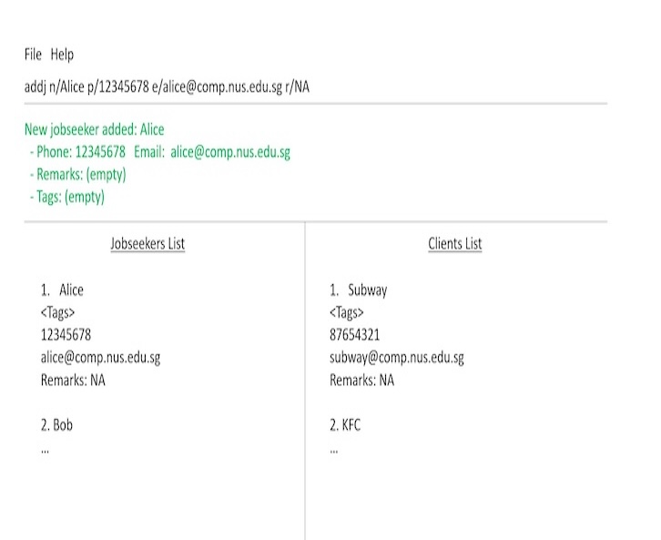

AddressBook Level 3 (AB3) is a **desktop application for managing contacts, optimized for use through a Command Line Interface (CLI)** while retaining the benefits of a Graphical User Interface (GUI). If you type quickly, AB3 can help you manage contacts faster than traditional GUI applications.

* Table of Contents
{:toc}

--------------------------------------------------------------------------------------------------------------------

## Quick start

1. Ensure that Java `25` or later is installed on your computer. 
   **Mac users:** Ensure you have the precise JDK version prescribed [here](https://se-education.org/guides/tutorials/javaInstallationMac.html).

1. Download the latest `.jar` file from [here](https://github.com/se-edu/addressbook-level3/releases).

1. Copy the file to the folder you want to use as the _home folder_ for your AddressBook.

1. Open a terminal, `cd` to the folder containing the JAR file, and run `java -jar addressbook.jar`. 
   A GUI similar to the one below should appear in a few seconds. Note how the app contains some sample data. 
   

1. Type a command in the command box and press Enter to execute it. For example, type **`help`** and press Enter to open the help window. 
   Some example commands you can try:

   * `list` : Lists all contacts.

   * `addj n/John Doe p/98765432 e/johnd@example.com a/John street, block 123, #01-01` : Adds a jobseeker named `John Doe` to the Address Book.

   * `addc n/Jane Tan p/91234567 e/jane@example.com a/123 Clementi Road r/Hiring engineers t/employer` : Adds a client named `Jane Tan` with a remark and tag.

   * `delete 3` : Deletes the 3rd contact shown in the current list.

   * `clear` : Deletes all contacts.

   * `exit` : Exits the app.

1. Refer to the [Features](#features) section below for details of each command.

--------------------------------------------------------------------------------------------------------------------

## Features

**:information_source: Notes about the command format:** 

* Words in `UPPER_CASE` are the parameters to be supplied by the user. 
  For example, in `addj n/NAME`, replace `NAME` with a value such as `John Doe`.

* Items in square brackets are optional. 
  For example, `n/NAME [t/TAG]` can be used as `n/John Doe t/friend` or as `n/John Doe`.

* Items followed by `…`​ can appear zero or more times. 
  For example, `[t/TAG]…​` may be omitted, or written as `t/friend` or `t/friend t/family`.

* Prefixed parameters can be in any order. 
  For example, if the command specifies `n/NAME p/PHONE_NUMBER`, `p/PHONE_NUMBER n/NAME` is also acceptable. For `editj`, `editc`, `tagj`, `untagj`, `tagc`, and `untagc`, the index must come first, followed by the fields or tags to update.

* Extraneous parameters for commands that take no parameters, such as `help`, `list`, `exit`, and `clear`, are ignored. 
  For example, `help 123` is interpreted as `help`.

* If you are using a PDF version of this document, be careful when copying and pasting commands that span multiple lines as space characters surrounding line-breaks may be omitted when copied over to the application.

### Viewing help: `help`

Shows a message explaining how to access the help page.

Format: `help`

### Adding a jobseeker: `addj`

Adds a jobseeker to the address book.

Format: `addj n/NAME p/PHONE_NUMBER e/EMAIL a/ADDRESS [r/REMARK] [t/TAG]…​`

:bulb: **Tip:**
A person can have any number of tags, including zero.

Examples:
* `addj n/John Doe p/98765432 e/johnd@example.com a/John street, block 123, #01-01`
* `addj n/Betsy Crowe t/friend e/betsycrowe@example.com a/Newgate Prison p/1234567 t/criminal`

Remarks and tags are optional. Append `r/Available immediately` when adding a jobseeker. Without `r/`, the remark is empty.
Append `t/urgent` when adding a jobseeker. Without `t/`, no tags are added.

### Adding a client: `addc`

Adds a client to the address book.

Format: `addc n/NAME p/PHONE_NUMBER e/EMAIL a/ADDRESS [r/REMARK] [t/TAG]…`

* Name, phone number, email, and address are required.
* The remark is optional. Omit `r/` or enter `r/` without text for an empty remark.
* Tags are optional. Repeat `t/TAG` to add multiple tags; omit it to add no tags. Each tag must be nonempty and alphanumeric.
* Specify each of `n/`, `p/`, `e/`, `a/`, and `r/` at most once. Repeated prefixes are rejected, except for `t/`.
* A client with the same name as an existing client is rejected, even if their remark differs. A jobseeker with the same name does not prevent adding the client.

Examples:

* `addc n/Jane Tan p/91234567 e/jane@example.com a/123 Clementi Road`
* `addc n/Jane Tan p/91234567 e/jane@example.com a/123 Clementi Road r/Hiring software engineers t/employer t/technology`

These examples are alternatives; adding both would attempt to add the same client twice.

### Listing all persons: `list`

Shows a list of all persons in the address book.

Format: `list`

### Editing a jobseeker: `editj`

Edits an existing jobseeker in the address book.

Format: `editj INDEX [n/NAME] [p/PHONE] [e/EMAIL] [a/ADDRESS] [r/REMARK] [t/TAG]…`

* The index is a positive integer from the currently displayed jobseeker list.
* At least one field must be provided. Fields you omit retain their existing values.
* Use `r/New remark` to replace a remark, or `r/` to clear it.
* Each of `n/`, `p/`, `e/`, `a/`, and `r/` may occur at most once.
* Supplied tags replace all existing tags. Use `t/` alone to clear all tags.
* Editing preserves hidden status and returns the view to the normal jobseeker list. An edited hidden jobseeker remains hidden.
* Edits that would duplicate another jobseeker's phone and email are rejected.

Examples:
* `editj 1 p/91234567 e/johndoe@example.com` updates the first displayed jobseeker's phone and email.
* `editj 2 r/Available immediately` replaces the second displayed jobseeker's remark.
* `editj 2 r/ t/` clears the second displayed jobseeker's remark and tags.

### Editing a client: `editc`

Format: `editc INDEX [n/NAME] [p/PHONE] [e/EMAIL] [a/ADDRESS] [r/REMARK] [t/TAG]…`

Works in the same way as `editj`, using the currently displayed client list. Editing returns the view to the normal client list, preserves hidden status, and rejects duplicate client phone-and-email combinations.

Examples:
* `editc 1 r/Hiring software engineers` updates the first displayed client's remark.
* `editc 1 r/` clears that client's remark.

### Managing Tags

#### Adding jobseeker tags: `tagj`

Adds tags to a jobseeker while preserving existing tags.

Format: `tagj INDEX TAG [MORE_TAGS]…`

* `INDEX` must be a positive integer referring to the currently displayed jobseeker list.
* Enter the index first, followed by at least one space-separated tag, without `t/`.
* Tags are case-sensitive and must contain only letters (`A–Z`, `a–z`) and digits (`0–9`).
* Tags the jobseeker already has are ignored.

Examples:

* `tagj 1 java` adds `java` to the 1st displayed jobseeker.
* `tagj 2 python teamwork` adds `python` and `teamwork` to the 2nd displayed jobseeker.

#### Removing jobseeker tags: `untagj`

Removes specified tags from a jobseeker while preserving other tags.

Format: `untagj INDEX TAG [MORE_TAGS]…`

* The index and tag rules are the same as for `tagj`.
* Tags the jobseeker does not have are ignored.

Examples:

* `untagj 1 java` removes `java` from the 1st displayed jobseeker.
* `untagj 2 python teamwork` removes `python` and `teamwork` from the 2nd displayed jobseeker.

#### Adding client tags: `tagc`

Adds tags to a client while preserving existing tags.

Format: `tagc INDEX TAG [MORE_TAGS]…`

* `INDEX` must be a positive integer referring to the currently displayed client list.
* Enter the index first, followed by at least one space-separated tag, without `t/`.
* Tags are case-sensitive and must contain only letters (`A–Z`, `a–z`) and digits (`0–9`).
* Tags the client already has are ignored.

Examples:

* `tagc 1 priority` adds `priority` to the 1st displayed client.
* `tagc 2 finance technology` adds `finance` and `technology` to the 2nd displayed client.

#### Removing client tags: `untagc`

Removes specified tags from a client while preserving other tags.

Format: `untagc INDEX TAG [MORE_TAGS]…`

* The index and tag rules are the same as for `tagc`.
* Tags the client does not have are ignored.

Examples:

* `untagc 1 priority` removes `priority` from the 1st displayed client.
* `untagc 2 finance technology` removes `finance` and `technology` from the 2nd displayed client.

### Finding jobseekers: `findj`

Finds jobseekers whose name, phone number or email contains any of the given keywords.

Format: `findj KEYWORD [MORE_KEYWORDS]…​`

* At least one keyword must be given.
* The search is case-insensitive; for example, `hans` matches `Hans`.
* Partial words match; for example, `Han` matches `Hans`, and `9435` matches the phone number `94351253`.
* Keyword order does not matter; for example, `Hans Bo` matches `Bo Hans`.
* Only the name, phone number and email are searched. Addresses, remarks and tags are not.
* Each keyword must match within a single field; for example, `Yeoh8743` does not match a jobseeker named `Alex Yeoh` whose phone number is `87438807`.
* Jobseekers matching at least one keyword are returned (an `OR` search); for example, `Hans Bo` returns `Hans Gruber` and `Bo Yang`.
* Hidden jobseekers are not searched. Use [`findhj`](#finding-hidden-jobseekers-findhj) to search them.
* Only the jobseeker list is filtered; the client list is left unchanged. Use `listj` to show all unhidden jobseekers again.

Examples:
* `findj alex david` returns `Alex Yeoh` and `David Li`.
* `findj li` returns `Charlotte Oliveiro` and `David Li`, since `li` appears inside both names.
* `findj 9103` returns `David Li`, whose phone number is `91031282`.

### Finding clients: `findc`

Finds clients whose name, phone number or email contains any of the given keywords.

Format: `findc KEYWORD [MORE_KEYWORDS]…​`

* The keywords are matched in the same way as for [`findj`](#finding-jobseekers-findj).
* Hidden clients are not searched. Use [`findhc`](#finding-hidden-clients-findhc) to search them.
* Only the client list is filtered; the jobseeker list is left unchanged. Use `listc` to show all unhidden clients again.

Examples:
* `findc roy` returns `Roy Balakrishnan`.
* `findc irfan@example.com` returns `Irfan Ibrahim`.

### Hiding a jobseeker: `hidej`

Hides the specified jobseeker, so that `listj` and `findj` no longer show them. Unlike deleting, hiding keeps the jobseeker and all their details in the address book.

Format: `hidej INDEX`

* Hides the jobseeker at the specified `INDEX`. The index refers to the index number shown in the displayed jobseeker list. The index **must be a positive integer** 1, 2, 3, …​
* The jobseeker disappears from the displayed list straight away.
* Hiding a jobseeker who is already hidden, for example one shown by `listhj`, changes nothing, and the result message says so.
* To see hidden jobseekers again, use [`listhj`](#listing-hidden-jobseekers-listhj) or [`findhj`](#finding-hidden-jobseekers-findhj).

Examples:
* `listj` followed by `hidej 2` hides the 2nd jobseeker in the jobseeker list.
* `findj Betsy` followed by `hidej 1` hides the 1st jobseeker in the results of the `findj` command.

### Hiding a client: `hidec`

Hides the specified client, so that `listc` and `findc` no longer show them. Unlike deleting, hiding keeps the client and all their details in the address book.

Format: `hidec INDEX`

* Works in the same way as [`hidej`](#hiding-a-jobseeker-hidej), but on the displayed client list.
* To see hidden clients again, use [`listhc`](#listing-hidden-clients-listhc) or [`findhc`](#finding-hidden-clients-findhc).

Examples:
* `listc` followed by `hidec 1` hides the 1st client in the client list.

### Listing hidden jobseekers: `listhj`

Shows a list of all hidden jobseekers.

Format: `listhj`

* Only the jobseeker list changes; the client list is left unchanged.
* Use `listj` to go back to the list of jobseekers who are not hidden.

### Listing hidden clients: `listhc`

Shows a list of all hidden clients.

Format: `listhc`

* Only the client list changes; the jobseeker list is left unchanged.
* Use `listc` to go back to the list of clients who are not hidden.

### Finding hidden jobseekers: `findhj`

Finds hidden jobseekers whose name, phone number or email contains any of the given keywords.

Format: `findhj KEYWORD [MORE_KEYWORDS]…​`

* The keywords are matched in the same way as for [`findj`](#finding-jobseekers-findj).
* Only hidden jobseekers are searched. Use `findj` to search the others.
* Only the jobseeker list is filtered; the client list is left unchanged. Use `listhj` to show all hidden jobseekers again.

Examples:
* `findhj alex` returns `Alex Yeoh`, if `Alex Yeoh` has been hidden.

### Finding hidden clients: `findhc`

Finds hidden clients whose name, phone number or email contains any of the given keywords.

Format: `findhc KEYWORD [MORE_KEYWORDS]…​`

* Works in the same way as [`findhj`](#finding-hidden-jobseekers-findhj), but on hidden clients.

Examples:
* `findhc irfan` returns `Irfan Ibrahim`, if `Irfan Ibrahim` has been hidden.

### Deleting a person: `delete`

Deletes the specified person from the address book.

Format: `delete INDEX`

* Deletes the person at the specified `INDEX`.
* The index refers to the index number shown in the displayed person list.
* The index **must be a positive integer** 1, 2, 3, …​

Examples:
* `list` followed by `delete 2` deletes the 2nd person in the address book.
* `find Betsy` followed by `delete 1` deletes the 1st person in the results of the `find` command.

### Clearing all entries: `clear`

Clears all entries from the address book.

Format: `clear`

### Exiting the program: `exit`

Exits the program.

Format: `exit`

### Saving the data

AddressBook automatically saves data after every command. You do not need to save manually.

### Editing the data file

AddressBook data is saved automatically as a JSON file `[JAR file location]/data/addressbook.json`. Advanced users are welcome to update data directly by editing that data file.

:exclamation: **Caution:**
If your changes make the data file invalid, AddressBook starts with an empty address book at the next run. The invalid file remains on disk until you run a command (AddressBook saves after every command). Still, we recommend backing up the file before editing it. 
Furthermore, certain edits can cause the AddressBook to behave in unexpected ways (e.g., if a value entered is outside of the acceptable range). Therefore, edit the data file only if you are confident that you can update it correctly.

### Archiving data files `[coming in v2.0]`

_Details coming soon ..._

--------------------------------------------------------------------------------------------------------------------

## FAQ

**Q**: How do I transfer my data to another computer? 
**A**: Install the app on the other computer and overwrite the data file it creates with the data file from your previous AddressBook home folder.

--------------------------------------------------------------------------------------------------------------------

## Known issues

1. **When using multiple screens**, if you move the application to a secondary screen, and later switch to using only the primary screen, the GUI will open off-screen. The remedy is to delete the `preferences.json` file created by the application before running the application again.
2. **If you minimize the Help Window** and then run the `help` command (or use the `Help` menu, or the keyboard shortcut `F1`) again, the original Help Window will remain minimized, and no new Help Window will appear. The remedy is to manually restore the minimized Help Window.

--------------------------------------------------------------------------------------------------------------------

## Command summary

Action | Format, Examples
--------|------------------
**Add jobseeker** | `addj n/NAME p/PHONE_NUMBER e/EMAIL a/ADDRESS [r/REMARK] [t/TAG]…`   e.g., `addj n/James Ho p/22224444 e/jamesho@example.com a/123, Clementi Rd, 1234665 r/Available immediately t/friend t/colleague`
**Add client** | `addc n/NAME p/PHONE_NUMBER e/EMAIL a/ADDRESS [r/REMARK] [t/TAG]…`   e.g., `addc n/Jane Tan p/91234567 e/jane@example.com a/123 Clementi Road r/Hiring engineers t/employer`
**Clear** | `clear`
**Delete** | `delete INDEX`  e.g., `delete 3`
**Edit jobseeker** | `editj INDEX [n/NAME] [p/PHONE] [e/EMAIL] [a/ADDRESS] [r/REMARK] [t/TAG]…`  e.g., `editj 2 r/Available immediately`
**Edit client** | `editc INDEX [n/NAME] [p/PHONE] [e/EMAIL] [a/ADDRESS] [r/REMARK] [t/TAG]…`  e.g., `editc 1 r/Hiring engineers`
**Find jobseekers** | `findj KEYWORD [MORE_KEYWORDS]…`  e.g., `findj James 9435 jake@example.com`
**Find clients** | `findc KEYWORD [MORE_KEYWORDS]…`  e.g., `findc Jane 9123`
**Find hidden jobseekers** | `findhj KEYWORD [MORE_KEYWORDS]…`  e.g., `findhj James 9435`
**Find hidden clients** | `findhc KEYWORD [MORE_KEYWORDS]…`  e.g., `findhc Jane`
**Hide jobseeker** | `hidej INDEX`  e.g., `hidej 2`
**Hide client** | `hidec INDEX`  e.g., `hidec 1`
**Add client tags** | `tagc INDEX TAG [MORE_TAGS]…`  e.g., `tagc 1 priority finance`
**Remove client tags** | `untagc INDEX TAG [MORE_TAGS]…`  e.g., `untagc 1 priority finance`
**Add jobseeker tags** | `tagj INDEX TAG [MORE_TAGS]…`  e.g., `tagj 1 java teamwork`
**Remove jobseeker tags** | `untagj INDEX TAG [MORE_TAGS]…`  e.g., `untagj 1 java teamwork`
**List** | `list`
**List hidden jobseekers** | `listhj`
**List hidden clients** | `listhc`
**Help** | `help`
